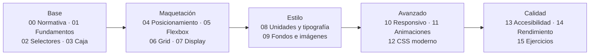

# CSS

## Apuntes de interfaces

**Módulos 0615 (DIW) · 0488 (DI)**

Diseño de interfaces web (DAW) · Desarrollo de Interfaces (DAM)

Curso 2026/2027

Note:
Bienvenidos a la parte de CSS de los apuntes de interfaces. Esta presentación os sitúa qué vamos a estudiar, con qué módulos se relaciona y cómo leer las diapositivas de todo el curso. Tres claves para seguir la clase: el resaltado marca la idea clave, el fragment aparece al avanzar y el Note son mis notas, que no se proyectan. Pregunta para romper el hielo: ¿en qué se diferencia CSS de JavaScript?

---

## Objetivos de la parte CSS

<span class="fragment">1. Situar el CSS en el <mark>marco normativo y curricular</mark> de los módulos</span>

<span class="fragment">2. Dominar los <mark>fundamentos</mark>: sintaxis, cascada, especificidad y herencia</span>

<span class="fragment">3. Seleccionar elementos con <mark>selectores, combinadores y pseudo-clases</mark></span>

<span class="fragment">4. Maquetar con posicionamiento, <mark>Flexbox</mark> y <mark>Grid</mark></span>

<span class="fragment">5. Cerrar con <mark>accesibilidad</mark>, rendimiento y buenas prácticas</span>

Note:
Cinco objetivos que ordenan las dieciséis unidades: primero la norma, después la técnica pura, luego la maquetación y por último la calidad. Los objetivos dos y tres son los que más se preguntan en el examen porque son los más prácticos. El cinco no es adorno: el currículo evalúa accesibilidad y usabilidad de forma explícita, con criterios propios. Y recordad que todo objetivo se comprueba con un criterio, no con una opinión.

---

## Qué cubre esta parte

<span class="fragment">Del <mark>marco normativo</mark> al <mark>CSS moderno</mark>: 16 unidades</span>

<span class="fragment">00–03: normativa, fundamentos, selectores y caja</span>

<span class="fragment">04–07: posicionamiento, Flexbox, Grid y display</span>

<span class="fragment">08–09: unidades, color, fondos e imágenes</span>

<span class="fragment">10–12: responsivo, animaciones y CSS moderno</span>

<span class="fragment">13–15: accesibilidad, rendimiento y ejercicios</span>

<span class="fragment">Cada unidad: teoría, código, errores y autoevaluación</span>

Note:
Este es el recorrido completo de la parte CSS, y coincide con la carpeta docs/css de los apuntes. Cada bloque se apoya en el anterior: sin especificidad no se entiende la cascada y sin modelo de caja no se entiende Flexbox. Os recomiendo encarecidamente no saltaros las unidades 00 a 03, aunque os parezcan teóricas. Son las que sostienen todo lo demás y las que más se preguntan en el examen teórico.

---

## A quién va dirigido

| Módulo | Ciclo | Papel del CSS |
|---|---|---|
| **0615 · DIW** | DAW | Núcleo de la asignatura |
| **0488 · DI** | DAM | Repaso previo a Angular |
| **0373 · LMH** | DAW | HTML y hojas de estilo básicas |

<span class="fragment">El <mark>DAW</mark> profundiza; el <mark>DAM</mark> consolida lo esencial</span>

<span class="fragment">Mismo material y mismo mapa, distinta profundidad según el módulo</span>

<span class="fragment">0615: 80 h y 9 ECTS · 0488: 70 h en segundo curso de DAM</span>

<span class="fragment">El 0373 aporta el <mark>RA 2</mark> con los criterios 2.g y 2.h</span>

Note:
En DAW el 0615 es el módulo nuclear, con ochenta horas de las que muchas se van en maquetación y responsividad. En DAM el 0488 repasa lo justo para que Angular no os pille desprevenidos. Si venís de otro ciclo, el mapa de unidades es idéntico: solo cambia el ritmo y la profundidad de los ejercicios. Fijaos en que los tres módulos se tocan en estas diapositivas.

---

## Mapa de las 16 unidades

```text
00 Normativa · 01 Fundamentos · 02 Selectores · 03 Caja
04 Posicionamiento · 05 Flexbox · 06 Grid · 07 Display
08 Unidades y color · 09 Fondos · 10 Responsivo · 11 Animaciones
12 CSS moderno · 13 Accesibilidad · 14 Rendimiento · 15 Ejercicios
```



<span class="fragment">Cinco bloques, dieciséis unidades, un solo hilo conductor</span>

<span class="fragment">La <mark>base</mark> es prerequisito de todo lo demás</span>

<span class="fragment">Las unidades se pueden repasar <mark>en cualquier orden</mark> una vez vista la base</span>

<span class="fragment">El bloque de <mark>calidad</mark> se cierra con ejercicios de todos los niveles</span>

Note:
El mapa se lee de izquierda a derecha: primero norma y fundamentos, después maquetación, estilo, CSS moderno y calidad. Es el mismo orden que siguen los apuntes escritos de la carpeta docs. Guardad esta imagen: os orientará siempre que preguntéis en qué unidad va cada cosa. El listado de arriba lo podéis copiar como índice de repaso rápido.

---

## Bloque base · Unidades 00–03

<span class="fragment"><mark>00</mark> Normativa: BOE, BOJA, RA, CE y el papel del W3C</span>

<span class="fragment"><mark>01</mark> Fundamentos: sintaxis, cascada, especificidad y herencia</span>

<span class="fragment"><mark>02</mark> Selectores: combinadores, pseudo-clases y pseudo-elementos</span>

<span class="fragment"><mark>03</mark> Modelo de caja: contenido, padding, borde y margen</span>

<span class="fragment">Si falláis aquí, falláis en todo el resto del curso</span>

<span class="fragment">Es el bloque más <mark>teórico</mark> y el que más se pregunta en el examen</span>

Sin estas cuatro unidades, el resto del curso se convierte en memorizar trucos de memoria sin entender por qué funcionan.

Note:
Son las cuatro unidades que dan el vocabulario común de la asignatura. La 00 responde a por qué estudiamos esto y la 01 a cómo funciona el motor de la cascada. En el examen, la especificidad de la unidad 01 es pregunta de manual casi seguro. El modelo de caja, además, es prerrequisito de cualquier maquetación con Flexbox o Grid.

---

## Bloque maquetación · Unidades 04–07

<span class="fragment"><mark>04</mark> Posicionamiento: static, relative, absolute, fixed, sticky</span>

<span class="fragment"><mark>05</mark> Flexbox: ejes, alineación y reparto en una dimensión</span>

<span class="fragment"><mark>06</mark> Grid: filas, columnas y áreas en dos dimensiones</span>

<span class="fragment"><mark>07</mark> Flujo, multicolumna, tablas y valores de display</span>

<span class="fragment">Del marco y la tabla a la <mark>cuadrícula</mark>: así evoluciona la maquetación</span>

<span class="fragment">Bloque con más <mark>horas de clase</mark> y más ejercicios prácticos</span>

Note:
Este bloque es el corazón práctico de la asignatura y donde más horas de clase se invierten. Fijaos en el orden: primero el posicionamiento, luego la caja flexible y por último la cuadrícula. El currículo habla de marcos, tablas y capas; en clase lo traducimos a flexbox y grid, que es su equivalente moderno. Aquí es donde se ven los resultados visuales más rápidos.

---

## Bloque estilo y avanzado · 08–12

<span class="fragment"><mark>08</mark> Unidades, tipografía y color pensados para pantalla</span>

<span class="fragment"><mark>09</mark> Fondos, imágenes, decoración y optimización de assets</span>

<span class="fragment"><mark>10</mark> Responsivo: media queries, clamp y container queries</span>

<span class="fragment"><mark>11</mark> Transiciones y animaciones con keyframes</span>

<span class="fragment"><mark>12</mark> CSS moderno: variables, capas, anidación y arquitectura</span>

<span class="fragment">Aquí aparece el CSS que se usa <mark>hoy</mark> en el trabajo</span>

Note:
Esta es la sección del CSS contemporáneo, la que os hará productivos desde el primer día. La unidad 12 conecta directamente con el RA 1 del módulo 0615, el de la guía de estilo y las plantillas de diseño. Si os interesan los temas, los design systems o la arquitectura de estilos, esta es vuestra parte del curso. Atención porque muchas propiedades son muy recientes.

---

## Bloque calidad · Unidades 13–15

<span class="fragment"><mark>13</mark> Accesibilidad: las WCAG aplicadas al CSS</span>

<span class="fragment"><mark>14</mark> Rendimiento, validación y buenas prácticas</span>

<span class="fragment"><mark>15</mark> Ejercicios, glosario y recursos de repaso</span>

<span class="fragment">Accesibilidad y usabilidad son <mark>requisitos del currículo</mark></span>

<span class="fragment">Se cierra el círculo validando con Jigsaw, stylelint y DevTools</span>

<span class="fragment">La unidad 15 es el <mark>repaso general</mark> antes del examen</span>

Note:
El bloque de calidad es el que distingue un perfil profesional de un aficionado. El módulo 0615 dedica resultados de aprendizaje enteros a accesibilidad y a usabilidad, con sus criterios correspondientes. La unidad 15 os sirve además de repaso general antes del examen, con ejercicios de todos los niveles. No la dejéis para la víspera.

---

## Cómo leer las diapositivas

<span class="fragment"><mark>mark</mark> → resalta la idea clave de la frase</span>

<span class="fragment"><mark>fragment</mark> → se revela al avanzar de diapositiva</span>

<span class="fragment"><mark>Note</mark> → notas del profesor; no se proyectan</span>

<span class="fragment"><code>---</code> separa diapositivas y <code>--</code> revela respuestas</span>

<span class="fragment">Bloques <code>css</code> y <code>html</code>: código listo para probar</span>

<span class="fragment">Tablas resumen, diagramas, y DevTools ante cualquier fallo</span>

Note:
La regla de lectura es simple: si está resaltado, es lo que hay que recordar. Los fragment os obligan a intentar responder antes de ver la respuesta, que es la mejor forma de estudiar. Los Note los leeréis en casa: resumen el porqué de cada diapositiva y avisan de las trampas de examen. Cuando veáis un diagrama, parad y explicadlo con vuestras palabras antes de pulsar avanzar.

---

## Estructura de cada unidad

<span class="fragment">1. <mark>Portada</mark> con los módulos y los objetivos de aprendizaje</span>

<span class="fragment">2. Motivación y <mark>alineación con el currículo</mark> de RA y CE</span>

<span class="fragment">3. Conceptos: una idea por diapositiva, con ejemplos de código</span>

<span class="fragment">4. Un diagrama, un <mark>error común</mark> y una autoevaluación</span>

<span class="fragment">5. Diapositiva final con las <mark>claves para el examen</mark></span>

<span class="fragment">La autoevaluación oculta la respuesta tras un guion doble</span>

<div style="font-size: 1em; text-align: left;">

El <mark>orden</mark> es siempre el mismo: portada, objetivos, motivación, conceptos, ejemplo, diagrama, error, autoevaluación y claves.
</div>

Note:
Todas las unidades siguen la misma plantilla para que sepáis dónde está cada cosa sin buscar. La mitad de la sesión se va en conceptos y la otra mitad en aplicarlos con código en el editor. La diapositiva de claves es la que conviene repasar la noche antes del examen. Si una unidad rompe la plantilla, es porque el contenido lo pedía así.

---

## Recursos y método de estudio

<span class="fragment">Apuntes completos en <code>docs/css</code>: teoría, ejemplos y ejercicios con solución</span>

<span class="fragment">Estas diapositivas son el <mark>guion de clase</mark>, no el material completo</span>

<span class="fragment">Validad en el <mark>validador W3C</mark> y depurad con las DevTools</span>

<span class="fragment">Documentación técnica de referencia: <mark>MDN Web Docs</mark></span>

<span class="fragment">Se aprende CSS escribiendo CSS: practicad en cada sesión</span>

<span class="fragment">Intentad el ejercicio antes de mirar la solución escrita</span>

Anotad vuestros errores frecuentes en una <mark>plantilla propia</mark>: os ahorrará la mitad del repaso final.

Note:
Las diapositivas no sustituyen a los apuntes: marcan el ritmo y los apuntes guardan los detalles, las tablas y los ejercicios. MDN es la fuente técnica de referencia y el validador W3C os dará la nota de cortesía en los trabajos. Mi consejo: abrid las DevTools desde la primera unidad y no las cerréis nunca. Y no copiéis soluciones sin haberlo intentado antes, porque el examen no las lleva.

---

## Ritmo del curso 2026/2027

<span class="fragment">Sesión 1: unidades 00 y 01 juntas, porque son la base</span>

<span class="fragment">Sesiones siguientes: selectores, modelo de caja y posicionamiento</span>

<span class="fragment">Mitad de curso: Flexbox y Grid con ejercicios de maquetación</span>

<span class="fragment">Tramo final: responsivo, accesibilidad y repaso de ejercicios</span>

<span class="fragment">Cada unidad termina con <mark>autoevaluación</mark> y claves de examen</span>

<span class="fragment">El calendario real se publica con la <mark>programación didáctica</mark></span>

Las sesiones prácticas se anuncian con <mark>antelación</mark> en el aula virtual.

Note:
Este es el plan orientativo de sesiones; si vamos con tiempo ampliamos los bloques prácticos y si no, comprimimos la teoría. El orden no se negocia porque cada unidad se apoya en la anterior. Id guardando las diapositivas de claves: con ellas os haréis vuestro índice de repaso. El calendario definitivo siempre sale de la programación didáctica del centro.

---

## ¿Por dónde empezamos?

<div style="font-size: 1em; text-align: left;">

Unidad 00: <mark>normativa y marco curricular</mark>. Antes de tocar código sabremos qué nos exige el currículo y quién lo dice.
</div>

<span class="fragment" style="font-size: 1em;">Traed dudas de cualquier apunte previo de HTML</span>

<span class="fragment" style="font-size: 1em;">Instalad un editor y abrid las DevTools del navegador</span>

<span class="fragment" style="font-size: 1em;">Guardad esta presentación como <mark>índice</mark> de toda la parte CSS</span>

<span class="fragment" style="font-size: 1em;">Recordad: <mark>mark</mark> es la clave, <mark>fragment</mark> se revela, <mark>Note</mark> es para vosotros</span>

Note:
Con esto cerramos la presentación general y entramos de lleno en la unidad 00. La siguiente diapositiva ya es la portada de normativa y marco curricular. Si alguien llega tarde, que se fije en el mapa de unidades: ahí está entero el curso en una sola imagen. Cualquier duda sobre el método de trabajo, dejadla para el final de la sesión.
