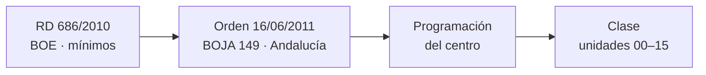

# CSS

## Unidad 0 · Normativa y marco curricular

**Módulos 0615 (DIW) · 0488 (DI)**

Diseño de interfaces web (DAW) · Desarrollo de Interfaces (DAM)

Curso 2026/2027

Note:
Bienvenidos a la unidad cero. Antes de escribir una línea de CSS vamos a situar qué nos exige el currículo y dónde se define, porque citar la norma correcta forma parte de la competencia profesional. Veremos la cadena normativa estatal y andaluza, los resultados de aprendizaje de los módulos y el papel del W3C. Pregunta inicial: ¿sabéis diferenciar el BOE del BOJA?

---

## Objetivos de aprendizaje

<span class="fragment">1. Identificar las <mark>normas estatales y autonómicas</mark> que rigen el ciclo DAW</span>

<span class="fragment">2. Relacionar cada contenido de CSS con su <mark>RA y su criterio de evaluación</mark></span>

<span class="fragment">3. Explicar el papel del <mark>W3C</mark> en la estandarización de CSS</span>

<span class="fragment">4. Distinguir las fases <mark>WD, CR y REC</mark> de una especificación</span>

Note:
Cuatro objetivos: tres de memorización y uno de comprensión. El segundo es el que dará estructura a todo el curso, porque cada unidad responderá a algún criterio de evaluación. El cuarto os evitará el error clásico de llamar CSS3 a una especificación.

---

## ¿Por qué empezar por la norma?

<span class="fragment">El currículo dice <mark>qué hay que saber hacer</mark>, no qué librería usar</span>

<span class="fragment">Justificar <mark>container queries</mark> exige citar la norma correcta</span>

<span class="fragment">La programación didáctica se apoya en la <mark>Orden de 2011</mark></span>

<span class="fragment">Distinguir BOE y BOJA evita errores en trabajos y en selectivos</span>

<span class="fragment">Es el primer contenido evaluado de los <mark>módulos de interfaces</mark></span>

Note:
Nadie estudia normas por gusto, pero en Formación Profesional la norma es el argumento con el que se defiende un contenido. Si en un trabajo citáis mal el diario o la fecha, la referencia deja de ser válida y se lleva por delante el resto del trabajo. Empezamos aquí para que todo lo demás tenga un marco.

---

## Alineación con el currículo

<div style="font-size: 1em; text-align: left;">

El CSS de estos apuntes se apoya en el <mark>RA 2 del módulo 0373</mark> y en cuatro RA del módulo 0615.
</div>

<span class="fragment" style="font-size: 1em;"><mark>0373 · RA 2</mark>: «Utiliza lenguajes de marcas para la transmisión de información a través de la Web»</span>

<span class="fragment" style="font-size: 1em;"><mark>CE 2.g</mark>: se han identificado las ventajas de las hojas de estilo → unidad 01</span>

<span class="fragment" style="font-size: 1em;"><mark>CE 2.h</mark>: se han aplicado hojas de estilo → unidades 01 a 12</span>

<span class="fragment" style="font-size: 1em;">Los <mark>RA 1, 5 y 6</mark> del 0615 cubren planificación, accesibilidad y usabilidad</span>

Note:
Los resultados de aprendizaje dicen lo que hay que saber hacer; los criterios de evaluación, cómo se comprueba que lo sabes hacer. Todo el cuerpo técnico de estas unidades responde a ese par RA-CE. El CE 2.h es el más transversal del curso: aparece en casi todas las unidades y se demuestra con código.

---

## Marco normativo estatal

| Norma | Qué establece |
|---|---|
| **RD 686/2010** | Título de DAW y mínimos |
| RD 1538/2006 | Ordenación general de la FP |
| LOE · LOMLOE | Marco legal y digital |

<span class="fragment">Las <mark>enseñanzas mínimas</mark> se amplían, nunca se recortan</span>

<span class="fragment">El ciclo tiene <mark>2.000 horas</mark> repartidas en dos cursos</span>

<span class="fragment">0612 y 0615: módulos de <mark>unidades de competencia</mark></span>

Note:
El RD 686/2010 es la referencia estatal: fija módulos, duración, equipamientos y perfil docente. Las enseñanzas mínimas se dan por supuestas en el examen, pero conviene saber de dónde salen. Ojo al citarlo como norma andaluza: el desarrollo autonómico es otra disposición distinta. Los módulos asociados a unidades de competencia son los que reconocen conocimientos ya adquiridos en el trabajo.

---

## Nivel autonómico · Andalucía

<span class="fragment"><mark>Orden de 16 de junio de 2011</mark>, BOJA n.º 149, de 1 de agosto de 2011</span>

<span class="fragment">Desarrolla RA, CE, contenidos, duración y orientaciones pedagógicas</span>

<span class="fragment">Es la <mark>norma de referencia</mark> de las programaciones didácticas</span>

<span class="fragment">El Decreto 436/2008 ordena la FP y faculta a la Consejería</span>

<span class="fragment">Incluye <mark>3 horas de libre configuración</mark> por departamento</span>

<div style="font-size: 1em; text-align: left;">

Comprobad siempre en el <mark>BOJA</mark> si hay órdenes posteriores antes de citar la norma en un trabajo formal.
</div>

Note:
La Orden de 2011 es la que os afecta directamente en clase: de ella salen los RA y los CE que se evalúan. Las horas de libre configuración son el hueco legal donde cabe el CSS avanzado que no aparece literalmente en los contenidos. Si citáis la norma sin comprobar su vigencia, una enmienda posterior dejaría vuestro trabajo desactualizado.

---

## La cadena normativa



<span class="fragment">Cadena: <mark>RD 686/2010 → Orden 16/06/2011 → programación</mark></span>

<span class="fragment"><mark>BOE</mark> para el Estado · <mark>BOJA</mark> para Andalucía</span>

Note:
Esta cadena es la respuesta modelo cuando os pidan justificar el alcance de un contenido. El Real Decreto pone los mínimos, la Orden los desarrolla a escala andaluza y la programación del centro los concreta. Si os saltáis un eslabón, el argumento se queda cojo y el tribunal lo nota enseguida.

---

## Módulo 0373 · LMH

<span class="fragment">128 horas y 7 ECTS de <mark>Lenguajes de marcas</mark></span>

<span class="fragment">El bloque de CSS responde al <mark>RA 2</mark> del módulo</span>

<span class="fragment"><mark>CE 2.g</mark>: identificar las ventajas de las hojas de estilo</span>

<span class="fragment"><mark>CE 2.h</mark>: aplicar hojas de estilo en documentos web</span>

<span class="fragment">Contenidos: estructura HTML, etiquetas, XHTML y <mark>hojas de estilo</mark></span>

Note:
El 0373 es el módulo de lenguajes de marcas del DAW y ahí se cuelan los fundamentos de CSS. El CE 2.g se responde en la unidad 01 y el CE 2.h acompaña a todo el curso. Si os preguntan en qué módulo se evalúa aplicar hojas de estilo, la respuesta es el 0373.

---

## Módulo 0615 · Los seis RA

<span class="fragment"><mark>RA 1</mark> planifica interfaces: color, tipografía y guía de estilo</span>

<span class="fragment"><mark>RA 2</mark> crea interfaces homogéneas con estilos y validación</span>

<span class="fragment"><mark>RA 3 y RA 4</mark> integran y verifican contenido multimedia</span>

<span class="fragment"><mark>RA 5</mark> exige interfaces accesibles según las WCAG</span>

<span class="fragment"><mark>RA 6</mark> pide interfaces amigables y verificación multi-navegador</span>

Note:
El 0615 es el módulo nuclear de la asignatura y sus seis RA recorren casi todo el temario, de la planificación a la usabilidad. Fijaos en el RA 5 y el RA 6: accesibilidad y usabilidad no son extra, son currículo evaluado. Los RA 3 y 4 conectan con la unidad 09 de imágenes y multimedia.

---

## Ejemplo · Del criterio al código

El CE 2.h se demuestra con <mark>una sola regla</mark> que unifica todas las tarjetas:

```css
/* RA 2 del 0615: clases de estilos */
.tarjeta {
  padding: 1rem;
  border: 1px solid #d0d0d0;   /* regla base compartida */
}
.tarjeta--destacado {
  border-color: crimson;       /* modificador sin duplicar */
}
```

<span class="fragment">Un cambio de declaración afecta a <mark>todas</mark> las tarjetas: eso es mantenibilidad</span>

<span class="fragment">El modificador ajusta un caso sin repetir la regla base</span>

Note:
Este fragmento es el argumento visual del CE 2.h: aplicar hojas de estilo significa cambiar el aspecto de muchos elementos desde un único sitio. El modificador evita duplicar estilos, que es exactamente lo que pide el RA 2 cuando habla de interfaces homogéneas. Copiadlo y cambiad el color en un solo sitio.

---

## Mapa de contenidos del curso

```text
Orden de 16/06/2011 (BOJA)
|-- 0373 · RA 2 -> hojas de estilo
|   |-- ventajas y aplicacion ....... U01, U02
|   `-- validacion .................. U14
`-- 0615 · RA 1 a RA 6
    |-- planificacion y color ........ U08, U12
    |-- maquetacion .................. U03 a U07
    |-- multimedia ................... U09
    |-- accesibilidad ................ U13
    `-- usabilidad y rendimiento ..... U14, U15
```

<span class="fragment">Cada <mark>criterio de evaluación</mark> apunta a una unidad concreta</span>

<span class="fragment">Si no sabéis dónde va algo, mirad este árbol antes que el índice</span>

<span class="fragment">El <mark>árbol</mark> responde también a preguntas de «¿dónde se evalúa X?»</span>

Note:
Este árbol es el puente entre la norma y los apuntes: cada rama termina en la unidad donde se practica. Os servirá para responder dónde se evalúa la accesibilidad sin memorizar el índice entero. Estad atentos a la rama del 0615, que es la más extensa y la que más se pregunta. Dibujadlo una vez a mano antes del examen: se os quedará grabado.

---

## El W3C y la estandarización

<span class="fragment">CSS no lo inventó un navegador: lo estandariza el <mark>W3C</mark></span>

<span class="fragment">Lo concreta el <mark>CSS Working Group</mark>, el grupo de trabajo de CSS</span>

<span class="fragment">Misión: «Making the web work — for everyone», la web <mark>para todos</mark></span>

<span class="fragment">Las especificaciones se publican en w3.org/TR y en drafts.csswg.org</span>

<span class="fragment"><mark>WHATWG</mark> mantiene HTML; el W3C mantiene CSS y las WCAG</span>

<span class="fragment">Las propuestas pasan por <mark>mailing list</mark>, borrador y recomendación</span>

Note:
Que CSS sea un estándar abierto es lo que garantiza que se comporte igual en Chrome, Firefox y Safari. El CSS Working Group es el sitio donde se discuten y se aprueban las propuestas nuevas. Recordad la distinción entre W3C y WHATWG: es pregunta frecuente de examen y de entrevista. Ningún navegador puede imponer una característica por su cuenta.

---

## Proceso de estandarización

<span class="fragment">1. <mark>Working Draft (WD)</mark>: borrador sin garantías de compatibilidad</span>

<span class="fragment">2. <mark>Candidate Recommendation (CR)</mark>: los navegadores deberían implementarlo</span>

<span class="fragment">3. <mark>Recommendation (REC)</mark>: estándar oficial y estable</span>

<span class="fragment">Solo la fase REC vale como estándar citable en licitaciones</span>

<span class="fragment">Toda cita lleva organismo, especificación, fase y <mark>fecha</mark></span>

<span class="fragment">Los borradores vivos se publican en <mark>drafts.csswg.org</mark></span>

Note:
La fase importa: un borrador puede cambiar o retirarse, una recomendación no. En trabajos formales hay que citar el organismo, la especificación, su fase y la fecha. Si os preguntan si una característica ya es norma, la respuesta depende de su fase, no de su nombre. Y si la spec está en borrador vivo, conviene decirlo también al citarla.

---

## De CSS 2.1 a los módulos

<span class="fragment"><mark>CSS1</mark> (REC 1996): tipografía, colores y modelo de caja</span>

<span class="fragment"><mark>CSS2 y CSS2.1</mark>: posicionamiento absoluto y floats</span>

<span class="fragment">Desde 2011 CSS se divide en <mark>módulos independientes</mark></span>

<span class="fragment">Cada módulo avanza con su nivel: Selectors L4, Grid L2, Color L5</span>

<span class="fragment">No existe la especificación «CSS4»: es <mark>terminología de marketing</mark></span>

Note:
Este es el cambio conceptual más importante de la unidad: CSS dejó de ser un documento único para convertirse en un conjunto de especificaciones que avanzan por separado. Por eso hoy se habla de CSS moderno y no de CSS4. En el examen se valora que citéis módulo y nivel, no la generación.

---

## Otros organismos y referencias

<span class="fragment"><mark>WHATWG</mark>: especificación de HTML en forma de Living Standard</span>

<span class="fragment"><mark>WCAG</mark>: requisitos de accesibilidad que CSS debe cumplir</span>

<span class="fragment">Son la base del <mark>RA 5</mark> del 0615: contraste, foco y movimiento</span>

<span class="fragment"><mark>MDN Web Docs</mark>: documentación y datos de compatibilidad</span>

<span class="fragment">Validador W3C de CSS para comprobar la sintaxis de las hojas</span>

Note:
HTML y CSS son complementarios pero tienen especificaciones distintas y organismos distintas. Las WCAG no son una especificación de CSS, pero condicionan cómo escribís color, foco y animación. MDN es la fuente didáctica de estos apuntes y os va a acompañar toda la vida profesional.

---

## Error común: citar mal la norma

⚠ El **RD 686/2010** no es la norma andaluza: el desarrollo es la Orden de 16/06/2011.

⚠ Confundir **BOE** y **BOJA**: el Estado publica en el BOE, la Consejería en el BOJA.

⚠ Decir «CSS3 es una especificación»: lo correcto es módulo con nivel y fase.

⚠ Fechar mal la Orden: es el **BOJA n.º 149, de 1 de agosto de 2011**.

Note:
Los tres primeros errores son los que más he visto en exámenes y los cuatro son de memoria, no de comprensión. El cuarto arrastra trabajos enteros mal citados. Si os dejáis un número o una fecha a medias, la referencia deja de ser utilizable y se penaliza.

---

## Autoevaluación

¿Qué normas se citan, y en qué orden, para justificar *container queries* en una programación didáctica?

--

**RD 686/2010** → Orden de 16/06/2011 (BOJA 149, con 3 h de libre configuración) → programación didáctica del centro.

Note:
Es la pregunta tipo de esta unidad y la respuesta es siempre la misma cadena de tres eslabones. Si os preguntan por BOE y BOJA, la respuesta es: Estado por el BOE y Consejería por el BOJA. Practicad la respuesta en voz alta, exactamente como la escribiríais en el examen.

---

## Claves para el examen

- **RD 686/2010** → Orden de 16/06/2011 (BOJA 149) → programación didáctica.
- CSS en el currículo: **RA 2 del 0373** y **RA 1, 2, 5 y 6 del 0615**.
- «CSS3» es marketing: se citan **módulos con nivel y fase** (WD, CR, REC).
- **W3C** estandariza CSS y WCAG; **WHATWG** mantiene HTML.
- **3 h de libre configuración** = CSS avanzado no citado literalmente.
- Toda cita lleva **número, fecha y diario** correctos.

Note:
Son seis reglas de memoria pura y son las que más se preguntan en el examen. La primera se puntúa completa o no se puntúa, así que practicadla entera. Si solo os retenéis un punto de esta lista, que sea el orden de la cadena normativa.
