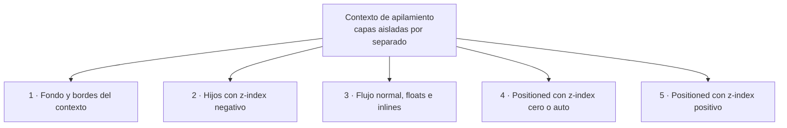

# CSS

## Unidad 4 · Posicionamiento y z-index

**Módulos 0615 (DIW) · 0488 (DI)**

Diseño de interfaces web (DAW) · Desarrollo de Interfaces (DAM)

Curso 2026/2027

Note:
En esta unidad vemos cómo sale una caja del flujo normal y cómo se ordenan las capas entre sí. `position` y `z-index` son el origen de mucha «magia negra» aparente, hasta que se entienden los contextos de apilamiento. Es un tema central en los exámenes de maquetación. Pregunta: ¿por qué un menú desplegable a veces queda debajo del contenido?

---

## Objetivos de aprendizaje

<span class="fragment">1. Distinguir los cinco valores de <mark>position</mark> y su efecto sobre el flujo</span>

<span class="fragment">2. Determinar el <mark>bloque contenedor</mark> de un absolute, un fixed y un sticky</span>

<span class="fragment">3. Explicar qué crea un <mark>contexto de apilamiento</mark> y en qué orden apila</span>

<span class="fragment">4. Gestionar <mark>z-index</mark> con variables e <mark>isolation: isolate</mark></span>

<span class="fragment">5. Construir overlays, modales centrados y cabeceras <mark>sticky</mark></span>

Note:
El objetivo central es el tercero: sin contextos de apilamiento, `z-index` parece aleatorio. El práctico es el quinto, con patrones que usaréis en cualquier proyecto. Los dos primeros son la base para no perderse en los ejercicios. El cuarto os librará de las guerras de capas.

---

## Motivación · El CSS que parece magia

<span class="fragment" style="font-size: 1em;">Se superpone en la página: menús, modales, tooltips</span>

<span class="fragment" style="font-size: 1em;">«<code>z-index: 9999</code> y no sube» es el fallo más frecuente</span>

<span class="fragment" style="font-size: 1em;">Sin <code>position</code> todo queda en <mark>flujo normal</mark></span>

<span class="fragment" style="font-size: 1em;">Un <code>transform</code> en un ancestro <mark>rompe</mark> un <code>fixed</code></span>

<span class="fragment" style="font-size: 1em;">Los fallos de capas vienen de <mark>contextos mal vistos</mark></span>

Note:
El posicionamiento está en todas las interfaces modernas y su comportamiento no siempre es obvio. La clave está en dos ideas: el bloque contenedor y el contexto de apilamiento. Una vez entendidas, el «truco» deja de ser truco. Con ellas resolvéis cualquier capa que se os ponga por delante.

---

## Los cinco valores de position

<span class="fragment"><mark>static</mark> (por defecto): flujo normal; ignora `top/right/bottom/left`</span>

<span class="fragment"><mark>relative</mark>: desplazamiento visual sin salir del flujo; el hueco se mantiene</span>

<span class="fragment"><mark>absolute</mark>: se ancla al bloque contenedor y el hueco original desaparece</span>

<span class="fragment"><mark>fixed</mark>: como absolute pero respecto al viewport, no se mueve al hacer scroll</span>

<span class="fragment"><mark>sticky</mark>: relative hasta un umbral y luego se pega como fixed dentro del padre</span>

Note:
Cinco valores, tres comportamientos distintos: flujo, flujo con desplazamiento y fuera del flujo. `static` ignora los offsets, por eso «mis top no funciona» casi siempre significa que falta un `position`. `sticky` es un híbrido que merece su propia diapositiva. Antes de cualquier cálculo, preguntad siempre: ¿este valor sale del flujo o no?

---

## absolute, fixed y sticky comparados

| Valor | ¿Respecto a qué? | ¿Sale del flujo? |
|---|---|---|
| `absolute` | Bloque contenedor | Sí |
| `fixed` | Viewport | Sí |
| `sticky` | Contenedor directo | No |

<span class="fragment">Los porcentajes de `top`/`left` se miden sobre el <mark>bloque contenedor</mark></span>

<span class="fragment"><mark>`relative`</mark> no sale del flujo y es el ancestro positioned más habitual</span>

Note:
La tabla resume lo que hay que memorizar de un vistazo: referencia y flujo. Fijaos en que `sticky` no sale del flujo, por eso sigue ocupando su hueco. La trampa de los porcentajes aparece mucho en ejercicios de centrado. Guardad `relative` en el contenedor lógico como costumbre de proyecto.

---

## Bloque contenedor

<span class="fragment">En `absolute`: el <mark>ancestro positioned más cercano</mark></span>

<span class="fragment">Sin ancestro: el <mark>initial containing block</mark> = viewport</span>

<span class="fragment">En `fixed`: el viewport, salvo <mark>transform</mark> o <mark>filter</mark></span>

<span class="fragment">En `sticky`: el <mark>padre directo</mark>; solo se mueve dentro</span>

<span class="fragment">`top: 50%` se mide sobre ese bloque, no la ventana</span>

<span class="fragment">`width`/`height` en % <mark>también</mark> se miden ahí</span>

Note:
El bloque contenedor es la referencia de todo el posicionamiento absoluto. El matiz crítico es el del fixed: `transform`, `filter`, `perspective` o `contain: paint` convierten a un ancestro en su bloque contenedor. De ahí vienen los modales que «saltan» al abrirse. Cuando dudéis, subid por el árbol hasta encontrar el primer elemento positioned.

---

## Offsets e `inset`

```css
.capa {
  position: absolute;  /* sin position, los offsets se ignoran */
  top: 1rem;
  right: 1rem;
  inset: 0;            /* atajo: rellena todo el bloque contenedor */
}
```

<span class="fragment">En `relative` son desplazamientos; admiten negativos</span>

<span class="fragment">Con `top` y `bottom`, la altura se resuelve entre ambos</span>

<span class="fragment">Con `left` y `right`, el ancho se resuelve igual</span>

<span class="fragment">`inset` resume los cuatro offsets en una sola línea</span>

Note:
Sin un `position` distinto de `static`, el navegador ignora silenciosamente estos offsets: es la causa más frecuente de «no me hace caso». `inset` es la forma moderna de escribir los cuatro valores juntos. Con offsets opuestos y tamaño `auto`, el navegador calcula el espacio restante. En `relative` los offsets admiten valores negativos.

---

## Qué crea un contexto de apilamiento

<span class="fragment">`position` distinto de `static` con <mark>`z-index` distinto de `auto`</mark>, incluso `0`</span>

<span class="fragment">Un item de flex o grid con <mark>`z-index` distinto de `auto`</mark></span>

<span class="fragment"><mark>`opacity` menor que 1</mark>, `transform`, `filter`, `backdrop-filter`</span>

<span class="fragment"><mark>`isolation: isolate`</mark>, la forma explícita y recomendada de aislar</span>

<span class="fragment">`will-change` con esas propiedades y `contain: paint` o `contain: strict`</span>

Note:
Un contexto de apilamiento es una capa aislada con su propia escalera de z-index. Si el elemento aísla su contenido con opacity o transform, crea contexto: es el truco para predecirlo. `isolation: isolate` es la forma limpia de crearlo sin efectos secundarios. Los `<iframe>` también abren su propio contexto.

---

## z-index: una regla y una trampa

<span class="fragment">Dentro de un contexto, los <mark>z-index se comparan entre sí</mark></span>

<span class="fragment">Fuera solo cuenta el <mark>z-index del propio contexto</mark>, no el de sus hijos</span>

<span class="fragment">Un hijo con `z-index: 9999` <mark>no sube</mark> si su padre no crea contexto</span>

<span class="fragment">La solución es subir el <mark>z-index del contenedor</mark>, nunca el del hijo</span>

<span class="fragment">Escalas de 9999 improvisadas acaban en <mark>caos de capas</mark></span>

Note:
Esta es la regla que resuelve el 90% de los problemas de capas: cada contexto compite solo con sus hermanos. Por eso subir el z-index del hijo no siempre funciona. Si el padre no crea contexto, el hijo compite en la escala global; si lo crea, queda atrapado dentro. Preguntad siempre: ¿quién crea contexto aquí?

---

## Escala de z-index con variables

```css
:root {
  --z-bajo: 1;       /* fondos decorativos */
  --z-header: 100;   /* cabecera sticky */
  --z-dropdown: 200;
  --z-modal: 300;
  --z-toast: 400;
}
/* aislamiento: .card { isolation: isolate; } */
```

<span class="fragment">Una <mark>escala documentada</mark> evita las guerras de números arbitrarios</span>

<span class="fragment">`isolation: isolate` <mark>aisla el componente</mark> y no contamina la escala global</span>

Note:
La escala de variables convierte el z-index en una decisión de diseño y no en una carrera de números. Reservad un rango para cada tipo de elemento y documentadlo en el proyecto. Con `isolation: isolate`, cada componente queda encapsulado y reutilizable. Id de diez en diez para dejar margen entre rangos.

---

## position: sticky en profundidad

```css
.cabecera {
  position: sticky;
  top: 0;                     /* umbral de enganche */
  z-index: var(--z-header);
}
```

<span class="fragment">Sin <mark>offset</mark> (`top`/`bottom`) no hace absolutamente nada</span>

<span class="fragment">Se pega <mark>dentro de su contenedor directo</mark>: al acabar este, se va con él</span>

<span class="fragment">Un ancestro con <mark>`overflow`</mark> se convierte en el scroll portador y lo rompe</span>

Note:
Sticky necesita dos cosas: una posición de enganche y un contenedor que pueda desplazarse. Si no se pega, revisad primero si hay `overflow` oculto en algún ancestro. Es ideal para cabeceras de tabla, índices laterales y barras de acción. Los márgenes del elemento desplazan el punto de enganche.

---

## fixed en móvil: dvh y safe-area

```css
.barra {
  position: fixed; bottom: 0; left: 0; right: 0;
  padding-bottom: env(safe-area-inset-bottom);
}
```

<span class="fragment">La barra de direcciones aparece y desaparece: la altura <mark>no es estable</mark></span>

<span class="fragment">Para alturas fiables usamos <mark>`dvh`, `svh` y `lvh`</mark> en lugar de `vh`</span>

<span class="fragment"><mark>`env(safe-area-inset-*)`</mark> evita tapar el notch o la barra de inicio</span>

<span class="fragment">Patrón típico: barras de acción inferiores y cabeceras fijas de aplicación</span>

Note:
Un `fixed` con referencia al viewport se comporta distinto en móvil, porque el propio viewport cambia al desplazarse. Las unidades dinámicas dan alturas estables y el safe-area protege las zonas sensibles del dispositivo. Este es el código obligatorio para cualquier barra inferior que no queráis que tape botones del sistema. Combinadlo con `sticky` cuando deba salir al final de su sección.

---

## Ejemplo · El z-index que no funciona

```html
<div class="tarjeta">
  <!-- sin position ni z-index: no crea contexto -->
  <button>Quiero salir arriba</button>
</div>
<nav class="menu"></nav>
<!-- .menu { position: relative; z-index: 10 } -->
```

<span class="fragment">El `nav` crea contexto con `z-index: 10` y <mark>gana</mark></span>

<span class="fragment">Arreglo: subir el `z-index` de la <mark>tarjeta</mark>, no el del botón</span>

Note:
Este es el ejemplo clásico de fallo. La tarjeta no crea contexto, así que compite en la escala global contra el nav. Fijaos en que la solución nunca es darle al botón un z-index enorme, sino dar contexto a la tarjeta. El síntoma típico es que el hijo no sube pese a su número.

---

## Ejemplo · Overlay y modal centrado

```css
.overlay {
  position: fixed; inset: 0;
  background: rgb(0 0 0 / .5);
  z-index: var(--z-modal);
}
.modal {
  position: fixed; inset: 0;
  margin: auto;          /* centra sin calcular posiciones */
  width: min(90vw, 32rem);
}
```

Note:
`inset: 0` con `margin: auto` centra la caja sin hacer cuentas de coordenadas. El overlay cubre todo el viewport y la escala de variables mantiene el modal por encima del resto. Es el patrón más reutilizable de la unidad. Añadid `overflow: auto` si el contenido del modal puede ser largo.

---

## Mapa · Orden dentro de un contexto



Note:
Este es el orden de apilamiento de atrás hacia delante dentro de un mismo contexto. Los elementos positioned con z-index auto o cero se resuelven por orden del DOM, y los positivos siempre por encima. Dibujad esta escalera en el examen antes de responder. El fondo del contexto siempre va el primero.

---

## Error común: posicionar sin contexto

<span class="fragment">⚠ `absolute` <mark>sin ancestro positioned</mark> vuela al viewport</span>

<span class="fragment">⚠ Subir `z-index` sin contexto en el padre no sirve</span>

<span class="fragment">⚠ Un `transform` crea bloque contenedor y rompe `fixed`</span>

<span class="fragment">⚠ Sticky no se pega: falta offset o hay `overflow`</span>

<span class="fragment">⚠ `top`/`left` sobre un `static` <mark>no hace nada</mark></span>

Note:
Todos los fallos de la diapositiva vienen de no identificar el bloque contenedor o el contexto correcto. Antes de tocar el z-index, preguntad: ¿qué elemento crea contexto aquí? El del transform es el más traidor porque rompe modales que funcionaban ayer. La solución habitual es montar el modal en `<body>`.

---

## Autoevaluación

<span class="fragment">1. Cita cinco formas de crear contexto de apilamiento además de position con z-index</span>

<span class="fragment">2. ¿Por qué un `fixed` dentro de un carrusel con `transform` se mueve con el carrusel?</span>

<span class="fragment">3. Tu tooltip con `z-index: 9999` sigue bajo la cabecera: dos causas posibles</span>

<span class="fragment">4. ¿Qué rompería antes un sticky: `overflow` en el body o en el padre directo?</span>

<span class="fragment">5. Escribe el CSS de una barra fija inferior que respete el safe-area de iOS</span>

Note:
Respuestas: uno, opacity, transform, filter, will-change, isolation: isolate o contain: paint. Dos, porque un ancestro con transform se convierte en su bloque contenedor. Tres, el padre no crea contexto o su ancestro tiene transform. Cuatro, el del padre directo; y en móvil, `env(safe-area-inset-bottom)`.

---

## Claves para el examen

<span class="fragment"><mark>static</mark> ignora offsets; relative sigue en el flujo; absolute y fixed salen</span>

<span class="fragment">Bloque contenedor: <mark>ancestro positioned más cercano</mark> o viewport</span>

<span class="fragment">Crea contexto: `position` con `z-index` ≠ auto, o <mark>opacity o transform</mark></span>

<span class="fragment">Dentro de un contexto los z-index <mark>se comparan entre sí</mark>: sube el contenedor</span>

<span class="fragment"><mark>sticky</mark> necesita offset y padre sin overflow; centrar: `inset: 0` + auto</span>

Note:
Cinco puntos que resumen toda la unidad. El cuarto es la pregunta estrella del examen: «tengo 9999 y no sube». Practicad los patrones de overlay y modal, que son los que más se repiten en los ejercicios. Repasad también el bloque contenedor al empezar.
