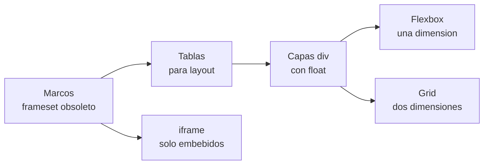

# CSS

## Unidad 7 · Flujo, display y tablas

**Módulos 0615 (DIW) · 0488 (DI)**

Diseño de interfaces web (DAW) · Desarrollo de Interfaces (DAM)

Curso 2026/2027

Note:
Bienvenidos a la unidad de flujo y sistemas de ordenación clásicos. Repasamos el flujo normal del documento, los valores de display, el BFC, los floats, las tablas CSS y la multicolumna. Es la base teórica que explica por qué hoy usamos flex y grid. Pregunta de arranque: ¿habéis maquetado alguna vez una página entera con tablas HTML?

---

## Objetivos de aprendizaje

<span class="fragment">1. Situar la evolución <mark>marcos → tablas → capas CSS</mark> de la maquetación</span>

<span class="fragment">2. Explicar qué caja genera cada valor de <mark>display</mark></span>

<span class="fragment">3. Crear un <mark>BFC</mark> con flow-root y controlar los floats con clear</span>

<span class="fragment">4. Estilizar tablas y componer layouts <mark>multicolumna</mark> editoriales</span>

Note:
Cuatro objetivos que van del contexto histórico al detalle técnico. El tercero es el más consultado en examen, porque flow-root sustituye al clearfix de toda la vida. El cuarto deja claros los dos sistemas vigentes: tablas para datos y columnas para prosa larga. Repasad el modelo de caja antes de empezar, porque todo lo de aquí se apoya en él.

---

## Motivación · Por qué lo clásico sigue vivo

<span class="fragment">Heredáis proyectos con floats y tablas de hace años</span>

<span class="fragment">Los contenedores colapsados vienen de <mark>floats</mark></span>

<span class="fragment">En examen: BFC y clear, que flex y grid asumen</span>

<span class="fragment">El flujo explica por qué grid y flex resuelven</span>

<span class="fragment">Las tablas HTML valen para datos, no para maquetar</span>

Note:
No estudiamos historia por nostalgia, sino por herencia de código real. Cuando heredáis una maquetación antigua, estos conceptos son los que hay que saber para no romper nada. Además, el vocabulario (contexto de formato, colapso, contención) aparece en las preguntas teóricas.

---

## Motivación · Tres eras de la maquetación

<div style="font-size: 1em; text-align: left;">

El RA 1 del módulo 0615 cita literalmente marcos, tablas y capas como sistemas de ordenación
</div>

| Era | Técnica | Problema principal |
|---|---|---|
| 1996–2000 | Marcos `<frameset>` | Sin SEO, sin impresión; obsoleto en HTML5 |
| 2000–2009 | Tablas para layout | Mezcla estructura y presentación; rígido |
| 2005–hoy | Capas `<div>` y CSS | Separación correcta: floats, flex y grid |

Note:
El recorrido va de soluciones cerradas a separar estructura y presentación. Los marcos desaparecieron de HTML5 y las tablas solo siguen vivas para datos tabulares. Si preguntan por marcos: obsoletos, y para embebidos se usa el `<iframe>`, que no es un frame de layout. Fijaos en que cada era nace para corregir el defecto de la anterior.

---

## El flujo normal del documento

<span class="fragment">Las cajas de bloque se apilan de arriba abajo y ocupan todo el ancho</span>

<span class="fragment">El texto inline llena la línea y rompe donde hace falta</span>

<span class="fragment">Los márgenes verticales adyacentes colapsan en uno solo</span>

<span class="fragment">El alto de un bloque lo decide su contenido, no la propiedad height</span>

<span class="fragment">Las cajas inline no admiten ancho ni alto, salvo que cambien de display</span>

Note:
Este es el comportamiento por defecto del que parte todo CSS. Conviene interiorizarlo porque casi todas las técnicas de esta unidad existen para corregir sus límites. Mirad el resultado en las devtools: el modelo sigue siendo caja más flujo. El colapso de márgenes es la primera sorpresa de quien empieza con CSS.

---

## display · el valor que define la caja

- `block`: ocupa la línea completa y acepta ancho, alto y márgenes
- `inline`: fluye con el texto e ignora ancho y alto
- `inline-block`: fluye como inline pero acepta dimensiones
- `none`: no genera caja y el elemento desaparece del render
- `contents`: sin caja propia; los hijos pasan al formato del abuelo
- `flow-root`: bloque que crea un BFC sin efectos secundarios

Note:
display decide qué caja se genera y qué propiedades tienen sentido en ella. Nótese que `run-in` está en la especificación pero ningún navegador lo implementa, así que no lo uséis. Los valores de flex y grid ya los manejáis de unidades anteriores. El valor `table-cell` también existe, pero solo tiene sentido dentro de una tabla.

---

## Block, inline e inline-block

```css
.bloque  { display: block;  width: 50%;  margin: 1rem auto; }
.inline  { display: inline; width: 50%; }   /* el ancho se ignora */
.enlinea { display: inline-block; width: 50%; vertical-align: top; }
```

<span class="fragment">A un `inline` solo le valen los márgenes horizontales</span>

<span class="fragment">Para alinear bloques en línea conviene flex, no trucos sueltos</span>

<span class="fragment">Un `<span>` con display block se comporta ya como caja de bloque</span>

Note:
La tríada clásica se resuelve en tres líneas de CSS. El ejemplo muestra la trampa habitual: declarar ancho a un inline y ver cómo no hace nada. Recuerda que `vertical-align` solo actúa en contextos inline, por eso no funciona en bloques puros. Cambiar display cambia el conjunto de propiedades útiles, no solo la forma.

---

## none y contents · qué se pierde

<span class="fragment">`display: none` retira el elemento también del árbol de accesibilidad</span>

<span class="fragment">`display: contents` deja a los hijos sin caja propia y expuestos</span>

<span class="fragment">Un `<fieldset>` con contents puede perder su leyenda en lectores</span>

<span class="fragment">Para ocultar «solo a la vista» se usan otras técnicas (unidad 13)</span>

Note:
Son los dos valores con más consecuencias prácticas. `none` es definitivo: ni render ni lectores de pantalla; `contents` borra la caja pero mantiene el contenido y sus estilos heredados. Cuidado al animar desde `none`: el navegador no calcula lo que no existe. En entrevistas técnicas se pregunta mucho la diferencia entre ambos.

---

## BFC · ámbito de render independiente

<div style="font-size: 1em; text-align: left;">

Un BFC aísla el render: lo que pasa dentro no afecta a lo de fuera
</div>

- La forma moderna de crearlo es <mark>display: flow-root</mark>
- También lo crean `overflow` distinto de visible y `position: fixed`
- Evita el colapso de márgenes y contiene los floats
- Un bloque con BFC no se pinta debajo de un float

Note:
El BFC es el concepto teórico que explica el clearfix y por qué flex y grid aíslan solos. `flow-root` es la píldora limpia: no recorta nada y resuelve el colapso. Los contextos flex y grid se crean automáticamente, por eso los contenedores modernos no necesitan trucos. Recordad la sigla: contexto de formato de bloque, ámbito de render independiente.

---

## float y clear · herencia técnica

```css
.figura { float: left; margin: 0 1rem 1rem 0; }   /* imagen en texto */
.limpiar::after { content: ""; display: block; clear: both; }
```

- El float extrae la caja y el texto inline fluye alrededor
- El padre no ve la altura del float: necesita BFC o clearfix
- `clear: left / right / both` baja hasta pasar el float
- Hoy el clearfix moderno es display: flow-root en el padre

Note:
Los floats ya no sirven para maquetar páginas, pero siguen siendo la forma correcta de flotar una imagen dentro de un texto. Sin contención, el pie de página se cuela por debajo de la imagen. Distinguid float para layout, antiguo y erróneo, de float para imagen, válido hoy. El `::after` del clearfix sigue en muchísimo código heredado.

---

## shape-outside · texto con forma

```css
.circulo {
  float: right;
  shape-outside: circle(50%);
  margin: 0 1.5rem 1rem 1.5rem;
}
```

- Solo actúa sobre elementos flotados: sin float no hay forma
- Define la silueta que rodea el texto, no el rectángulo de la caja
- `shape-margin` añade aire entre la forma y las palabras
- Si recortas la imagen con `clip-path`, la forma debe coincidir

Note:
Es el detalle que separa un artículo de prensa de un texto pegado a un rectángulo. El navegador solo pinta el texto dentro de la caja, así que el propio elemento sigue recortado por su forma. Hay soporte bueno en los tres motores para formas básicas. Es ampliación, pero aparece en preguntas de diseño editorial.

---

## CSS Tables · propiedades clave

<span class="fragment"><mark>table-layout: fixed</mark> toma los anchos de la primera fila o de `<col>`</span>

<span class="fragment">Con `auto` manda el contenido: cálculo más lento e impredecible</span>

<span class="fragment">`border-collapse: collapse` compartes bordes, estilo grid clásico</span>

<span class="fragment">`border-spacing` y `empty-cells` solo actúan en `separate`</span>

<span class="fragment">`vertical-align` y `text-align: end` alinean el contenido de la celda</span>

Note:
Las tablas HTML son semántica de datos; CSS solo las estiliza y con ellas nunca se maquetan páginas. El par que más se pregunta es `table-layout: fixed` frente a `auto`, por rapidez y predictibilidad. El `<caption>` se coloca con `caption-side`, arriba o abajo. Los números suelen alinearse a la derecha o al final del texto.

---

## Multicolumna editorial

```css
.glosario {
  columns: 2 300px;      /* column-count + column-width */
  column-gap: 3rem;
  column-rule: 1px solid #ddd;
}
.glosario dt { break-after: avoid; }   /* no separar término y definición */
```

- Las columnas las <mark>crea el texto</mark>: nada se coloca «en la columna 2»
- Con las dos medidas, `column-width` actúa como ancho mínimo
- `span: all` deja que un subtítulo cruce todas las columnas
- Para textos verticales existe `writing-mode: vertical-rl`

Note:
La multicolumna es para contenido denso tipo revista o catálogo, no para layout de página. El flujo es vertical dentro de cada columna: primero se llena la primera. Si necesitáis repartir tarjetas iguales, eso es grid con auto-fit, no columnas. Con `columns` el navegador decide cuántas caben según el ancho disponible.

---

## Ejemplo · tabla que se vuelve tarjeta

```css
.tabla-wrap { overflow-x: auto; }    /* alternativa: scroll en móvil */
@media (max-width: 600px) {
  .tabla tr, .tabla td { display: block; }
  .tabla td { display: flex; justify-content: space-between; }
  .tabla td::before { content: attr(data-label); }   /* etiqueta visible */
}
```

<span class="fragment">Cada celda recupera su etiqueta con attr(data-label)</span>

<span class="fragment">Se mantiene la semántica de tabla: el dato repite su `<th>`</span>

<span class="fragment">La alternativa ligera es dejar overflow-x en el envoltorio</span>

Note:
Este patrón convierte filas en tarjetas sin salir de la tabla semántica. La alternativa más ligera es dejar `overflow-x: auto` en el envoltorio y ya está. Cuidado con el scroll horizontal: mejor un dato visible que un carrusel escondido. El `data-label` se rellena en el HTML y se lee con `attr()` en CSS.

---

## Ejemplo · imagen flotada con BFC

```css
.articulo { display: flow-root; }    /* el padre sí ve los floats */
.articulo img { float: left; margin: 0 1rem 1rem 0; }
.articulo p { margin-block: 0 1rem; }
```

<span class="fragment">Sin BFC el contenedor no sube y el pie se solapa con la imagen</span>

<span class="fragment">`flow-root` no recorta, a diferencia de `overflow: hidden`</span>

<span class="fragment">El texto fluye alrededor y la sombra de la foto queda visible</span>

Note:
Esta es la receta completa de imagen en texto: float, márgenes y un padre con flow-root. Si quitáis la primera línea veréis el bug clásico del contenedor colapsado. Comparadlo con lo que haría grid: dos columnas fijas, sin texto fluyendo. Guardad este bloque, es el que se pide en los ejercicios.

---

## Diagrama · Evolución de los sistemas de ordenación



Note:
La flecha de marcos a iframe es importante: los frames de layout desaparecieron, pero el iframe sigue para embeber contenido externo. A partir de ahí todo lo que se ordena con CSS entra en el mismo árbol, con el documento. Flex y grid no compiten: resuelven una y dos dimensiones. El float queda como recurso puntual, no como sistema.

---

## Error común: overflow hidden para crear BFC

⚠ `overflow: hidden` <mark>recorta</mark> tooltips y sombras

⚠ `table-cell` suelto crea envoltorios anónimos raros

⚠ Sin contención el padre no sube y el pie se solapa

⚠ Maquetar con tablas: rígido, pesado y poco accesible

⚠ `display: none` también oculta para <mark>lectores</mark>

Note:
El primero es el error de moda: sí crea contexto, pero recorta todo lo que sobresalga. La solución correcta es `display: flow-root`. Los tres siguientes son herencia de proyectos antiguos y conviene detectarlos al heredar una maquetación. El último se ve en webs que rompen el zoom y la lectura con pantalla.

---

## Autoevaluación

<span class="fragment">1. ¿Por qué `display: contents` puede ser peligroso para la accesibilidad?</span>

<span class="fragment">2. Nombra tres formas de crear un BFC y una utilidad de cada una</span>

<span class="fragment">3. ¿Cuándo es legítimo usar `float` hoy? ¿Y `clear: both`?</span>

--

**1)** Deja a los hijos sin caja propia y puede perder el nombre del contenedor.

**2)** `flow-root`, `overflow` distinto de visible y `position: absolute`.

**3)** Flotar imágenes en texto; `clear: both` baja hasta pasar todos los floats.

Note:
Estas tres preguntas resumen los puntos de examen de la unidad. Si falláis la segunda, repasad la diapositiva del BFC: casi siempre se olvida que flex y grid también crean contexto por sí mismos. La primera conecta con accesibilidad, tema que se retoma en la unidad 13. La tercera separa el uso legítimo del abuso histórico.

---

## Claves para el examen

- `block` ocupa la línea, `inline` ignora ancho y alto, `inline-block` une ambos
- `none` borra el elemento; `contents` deja a los hijos sin caja propia
- `flow-root` crea un BFC sin recortar; `overflow` ≠ visible, pero recorta
- Hoy `float` solo para imágenes en texto; el clearfix moderno es `flow-root`
- `table-layout: fixed` calcula por la primera fila: rápido y predecible
- Multicolumna para prosa; para repartir tarjetas, grid con `auto-fit`

Note:
Cuatro ideas finales: display, BFC, float y tabla. Si os tragáis estas seis líneas, aprobáis la unidad. El resto, como shape-outside o writing-mode, es ampliación para quien quiera profundizar. Antes del examen, abrid el ejemplo de imagen flotada y quitad la primera línea para ver el fallo en vivo.
