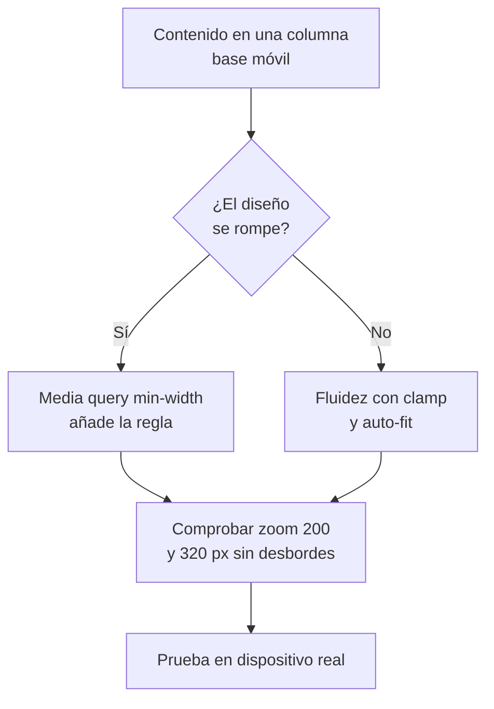

# CSS

## Unidad 10 · Diseño responsivo

**Módulos 0615 (DIW) · 0488 (DI)**

Diseño de interfaces web (DAW) · Desarrollo de Interfaces (DAM)

Curso 2026/2027

Note:
Bienvenidos a la unidad de diseño responsivo. El objetivo es una sola base de código que se adapte a cualquier viewport, orientación y capacidad del dispositivo. Trabajamos mobile-first, media queries, tipografía fluida y container queries. Pregunta de arranque: ¿en qué tamaño de pantalla miráis vuestro proyecto por última vez?

---

## Objetivos de aprendizaje

<span class="fragment">1. Aplicar la filosofía <mark>mobile-first</mark> con consultas de tipo min-width</span>

<span class="fragment">2. Escribir tipografía y espaciado fluidos con <mark>clamp()</mark> y topes</span>

<span class="fragment">3. Derivar los breakpoints del <mark>contenido</mark> y expresarlos en em</span>

<span class="fragment">4. Distinguir media queries de <mark>container queries</mark> y usar cada una</span>

Note:
Cuatro objetivos que forman la cadena del responsivo: base móvil, fluidez, puntos de quiebre y componente. El cuarto es el más moderno y el que más se confunde en examen. A ellos se suma la accesibilidad con las funciones preferencias del usuario, transversal a toda la unidad. Practicad con la misma maqueta en varios anchos.

---

## Motivación · Una base de código, cualquier pantalla

<div style="font-size: 1em; text-align: left;">

Diseño responsivo, Ethan Marcotte 2010: layout fluido, imágenes flexibles y media queries
</div>

<span class="fragment">Un solo proyecto que se adapta a móvil, tablet, escritorio y televisor</span>

<span class="fragment">Sin el meta viewport el móvil emula 980 px y reduce el texto</span>

<span class="fragment">El objetivo real: que nada se corte a 320 px ni con zoom del 200 %</span>

<span class="fragment">Menos código que mantener que tres versiones paralelas del sitio</span>

Note:
El responsivo no es una plantilla, es una forma de escribir CSS desde el inicio. La promesa original de Marcotte sigue vigente y se completa hoy con clamp y container queries. Comprobadlo vosotros: redimensionad la ventana y mirad dónde se rompe. Cualquier arreglillo posterior sale más caro que hacerlo bien desde el principio.

---

## Motivación · No solo móvil

<div style="font-size: 1em; text-align: left;">

Pensar solo en móvil es quedarse corto: hay pantallas en las dos direcciones
</div>

<span class="fragment">Tablet en las dos orientaciones y portátiles de 13 pulgadas</span>

<span class="fragment">Monitores grandes y televisores a dos o tres metros de distancia</span>

<span class="fragment">Impresión y vista previa: el layout también se saca en papel</span>

<span class="fragment">Preferencias del usuario: tema, movimiento y alto contraste</span>

Note:
El responsivo cubre desde 320 px hasta pantallas de salón, y también las preferencias. Por eso los breakpoints superiores existen, aunque la mayoría del tráfico sea móvil. Las preferencias del usuario entran por media queries, no por tamaño. Tened presentes los extremos al diseñar.

---

## Requisito 0 · el meta viewport

```html
<meta name="viewport" content="width=device-width, initial-scale=1">
```

- Sin él el navegador móvil emula unos 980 px y escala la página
- El texto sale diminuto y hay que pellizcar para leerlo
- Se coloca en el `<head>` de todas las plantillas modernas
- Con él, `width=device-width` toma el ancho real del dispositivo
- `initial-scale=1` evita el zoom automático del navegador móvil

Note:
Es lo primero que se comprueba cuando «el móvil se ve raro». El emulador de escritorio rara vez lo delata, por eso conviene probar en dispositivo real. Sin esta línea, todo lo demás de la unidad da igual. Es una sola etiqueta, pero decide si el resto del CSS se aplica bien.

---

## Mobile-first con min-width

```css
/* Base = móvil */
.tarjetas { display: grid; gap: 1rem; }

@media (min-width: 48em) {   /* tablet */
  .tarjetas { grid-template-columns: repeat(2, 1fr); }
}
@media (min-width: 64em) {   /* escritorio */
  .tarjetas { grid-template-columns: repeat(3, 1fr); }
}
```

- Las reglas base ya son usables en móvil sin más ajustes
- Menos overrides que empezar con max-width, que es desktop-first
- Los navegadores antiguos ven la versión simple: progresión natural

Note:
Mobile-first invierte el orden: defines lo mínimo y amplías. Cada consulta añade columnas, nunca las quita. La ventaja técnica es la cascada limpia; la de proyecto, que fuerza a priorizar el contenido en la columna estrecha. El valor `48em` equivale a 768 px con el tamaño por defecto de texto.

---

## Fluidez antes que breakpoints

```css
.contenedor { width: min(100% - 2rem, 70rem); margin-inline: auto; }
.galeria {
  grid-template-columns: repeat(auto-fit, minmax(min(100%, 16rem), 1fr));
}
.prosa { font-size: clamp(1rem, .9rem + .5vw, 1.125rem); }
```

- Buena parte del responsivo no necesita ninguna media query
- El breakpoint solo cuando el diseño cambia de estructura
- `margin-inline: auto` centra el contenedor con propiedades lógicas
- Padding, gap y márgenes también admiten `min()` y `clamp()`
- El tope del contenedor evita líneas de texto eternas en pantallas anchas

Note:
Antes de abrir una consulta, preguntad si `min()`, `auto-fit` o `clamp()` ya lo resuelven. Los breakpoints se reservan para cambios estructurales, como pasar de menú a hamburguesa. Así el CSS queda corto y el resultado, más suave entre tamaños. La galería con auto-fit se reordena sola según el hueco.

---

## Media queries y features

```css
@media (min-width: 40em) and (prefers-color-scheme: dark) { /* … */ }
```

| Feature | Valores típicos |
|---|---|
| `width` | `min-width` / `max-width` |
| `hover`, `pointer` | `fine`, `hover`, `none` |
| `prefers-*` | `reduce`, `dark` |

- `and` combina condiciones y la coma significa o
- `resolution` sirve imágenes nítidas en pantallas retina

Note:
La sintaxis es simple, pero el interés está en las features disponibles. Fuera del ancho, las que más se usan detectan el tema del sistema y el tipo de puntero. Recordad que varias funciones separadas por coma actúan como un o lógico. Las features de resolución permiten servir fondos nítidos en retina.

---

## Accesibilidad en consultas

<span class="fragment">`prefers-reduced-motion: reduce` apaga animaciones no esenciales</span>

<span class="fragment">`prefers-contrast` y `forced-colors` respetan los ajustes del sistema</span>

<span class="fragment">`(hover: none)` detecta dispositivo táctil sin ratón</span>

<span class="fragment">`prefers-reduced-transparency` evita el vidrio sobre fondo complejo</span>

Note:
Estas consultas leen preferencias de la persona usuaria, no del dispositivo. El bloque de movimiento reducido se escribe una vez y de forma global con el selector universal. Sin él no se publica: puede provocar mareo real a parte del alumnado. El modo de colores forzado lo usan sistemas con paletas limitadas.

---

## Tipografía fluida con clamp

```css
:root {
  --fs-h1: clamp(2.25rem, 1.6rem + 2.2vw, 4rem);
  --fs-h2: clamp(1.75rem, 1.4rem + 1.2vw, 2.5rem);
  --space-section: clamp(3rem, 2rem + 4vw, 6rem);
}
```

- Fórmula: <mark>clamp(mínimo, valor fluido, máximo)</mark>
- Aplica a tamaños, `padding`, `gap` y `margin` del ritmo visual
- Siempre con topes para no romper en pantallas extremas
- Se combina con la escala modular de la unidad 8 para tokens fluidos

Note:
El valor intermedio es una recta entre dos puntos de diseño y crece con el viewport. Se puede deducir a mano o con calculadoras de tipografía fluida. Como se guarda en tokens, toda la escala queda fluida con una sola línea por nivel. Los topes evitan tipografía gigante en televisores.

---

## Breakpoints · se derivan del contenido

<span class="fragment">Diseña en móvil y busca dónde el layout se rompe o mejora</span>

<span class="fragment">Referencias: 480, 768, 1024, 1280 y 1536 px, ajustadas al proyecto</span>

<span class="fragment">Escríbelos en em, no en px, para respetar el zoom del usuario</span>

<span class="fragment">Agrupa cambios coherentes: nada de un breakpoint por característica</span>

<span class="fragment">Documenta la escala en la guía de estilo como tokens</span>

Note:
No existen breakpoints universales: salen de vuestro contenido. En `em` la consulta responde también al tamaño de texto, cosa que en `px` no ocurre. Documentad la escala en la guía de estilo para que el equipo entienda el sistema. El truco está en medir el contenido, no el dispositivo.

---

## Container queries

```css
.tarjeta-wrap {
  container-type: inline-size;   /* observa el ancho del hueco */
  container-name: tarjeta;
}
@container tarjeta (min-width: 30rem) {
  .tarjeta { grid-template-columns: 12rem 1fr; }
}
```

- Las media queries miran el viewport; estas miran el contenedor
- `inline-size` cubre la inmensa mayoría de los casos reales
- Unidades propias: `cqw`, `cqh`, `cqi`, `cqmin` y `cqmax`
- El contenedor se declara en el envoltorio, no en la consulta

Note:
La container query resuelve el problema del componente reutilizable que vive en sitios de distinto ancho. La sintaxis es idéntica a `@media`, pero evaluada contra el envoltorio. Con `size` miras también el alto, exigiendo altura definida en ese eje. El nombre del contenedor permite apuntar a varios contenedores anidados.

---

## MQ o CQ · qué técnica toca

<span class="fragment">Cambia la estructura de la página, como nav o sidebar → media query</span>

<span class="fragment">Cambia un componente según su hueco → <mark>container query</mark></span>

<span class="fragment">Preferencias del usuario, tema o movimiento → funciones `prefers-*`</span>

<span class="fragment">Las style queries, `@container style(--x)`, aún se están consolidando</span>

<span class="fragment">Un widget en sidebar estrecha y en main ancho usa CQ, no MQ</span>

Note:
Este es el criterio de decisión que más se pregunta. Si cambia la página, viewport; si cambia el componente, contenedor; si cambia la persona, preferencia. Mezclarlos a ciegas produce CSS redundante y difícil de mantener. El ejemplo del widget es el clásico de examen de esta unidad.

---

## Ejemplo · consultas combinadas de accesibilidad

```css
@media (hover: hover) and (pointer: fine) {
  .card:hover { transform: translateY(-2px); }
}
@media (prefers-reduced-motion: reduce) {
  *, *::before, *::after {
    animation-duration: .01ms !important;
    transition-duration: .01ms !important;
  }
}
```

<span class="fragment">El hover solo para ratones reales; el táctil usa `:active` y foco</span>

<span class="fragment">Un bloque global para respetar al usuario sin excepciones</span>

<span class="fragment">Con `scroll-behavior` también se desactiva el desplazamiento suave</span>

Note:
Combinar `hover` y `pointer` evita estados que solo existen en escritorio. El bloque de movimiento reducido es el punto de entrada único para la preferencia de animación. Fijaos en los `important`: son la excepción justificada de la especificidad. El mismo patrón se aplica a las transiciones y a los desplazamientos.

---

## Ejemplo · carrusel nativo con scroll-snap

```css
.carrusel {
  display: flex; gap: 1rem;
  overflow-x: auto;
  scroll-snap-type: x mandatory;
  scrollbar-width: none;
}
.carrusel > * { scroll-snap-align: start; }
```

- Carrusel responsivo con scroll nativo y cero JavaScript
- `env(safe-area-inset-*)` reserva el hueco de la notcha
- `text-wrap: balance` evita titulares con una palabra sola
- `overscroll-behavior: contain` impide que robe el scroll de la página

Note:
El scroll-snap da un carrusel accesible porque usa el scroll del propio sistema. Con `always` en `scroll-snap-stop` no se saltan dos tarjetas de golpe. Las áreas seguras evitan que la esquina redondeada o la cámara tape el contenido. Es la alternativa moderna a las librerías de carruseles.

---

## Diagrama · Flujo mobile-first



Note:
El flujo empieza siempre por el contenido en una sola columna. Solo si el diseño se rompe se abre una consulta; si no, manda la fluidez. El último paso no es negociable: el emulador no reproduce gestos, barras ni teclado del dispositivo real. Imprimir este flujo y pegarlo en la pared ayuda mucho.

---

## Error común: desktop-first y breakpoints en px

⚠ Empezar con `max-width`: overrides encadenados

⚠ Breakpoints en px sin tope rompen en TV y monitores

⚠ `100vh` fijo en móvil falla: usa `100dvh`

⚠ Hover único: el táctil se queda sin feedback

⚠ Olvidar `prefers-reduced-motion` marea

⚠ Probar solo en el emulador deja gestos sin ver

Note:
El primer error es estructural y encarece todo el mantenimiento. El de los px en breakpoints es el que provoca el típico corte raro en pantallas grandes. Los tres últimos son de accesibilidad y se detectan probando con el teclado y con movimiento reducido. Casi siempre aparecen juntos en el mismo proyecto.

---

## Autoevaluación

<span class="fragment">1. Escribe la consulta: pantalla ≥ 768 px y modo oscuro preferido</span>

<span class="fragment">2. ¿Por qué `container-type: inline-size` basta para la mayoría?</span>

<span class="fragment">3. Diferencia `svh`, `dvh` y `lvh`, y di cuál usas por defecto</span>

--

**1)** `@media (min-width: 48em) and (prefers-color-scheme: dark)`.

**2)** Porque los widgets casi siempre miden su ancho, no su alto.

**3)** `svh` barra visible, `lvh` barra oculta, `dvh` dinámica; por defecto `dvh`.

Note:
La primera pregunta combina dos features con `and` y se resuelve mejor en em. La segunda toca el porqué de la container query más usada. La tercera conecta con la unidad 8 y con el problema clásico de la barra de direcciones. Si falláis la primera, repasad la sintaxis de la consulta.

---

## Claves para el examen

- Mobile-first con `min-width`: menos overrides y progresión natural
- `clamp(min, ideal, max)` da tipografía y espaciado fluidos con topes
- Los breakpoints salen del contenido y se escriben en `em`
- MQ mira el viewport; `@container` mira el hueco del componente
- Sin `prefers-reduced-motion` no se publica: es accesibilidad
- Prueba en dispositivo real: el emulador miente

Note:
Estas seis líneas son el resumen operativo de la unidad. Las tres primeras son de estrategia, la cuarta de técnica moderna y las dos últimas de calidad. Si aplicáis el flujo del diagrama, el resto aparece solo. Repasad también la tabla de features antes del examen.
