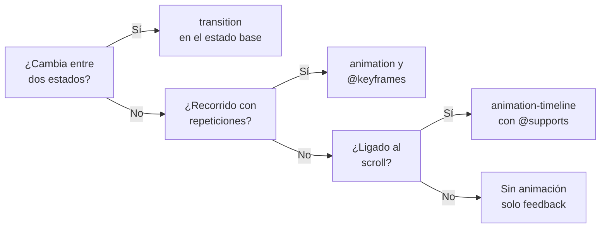

# CSS

## Unidad 11 · Transiciones y animaciones

**Módulos 0615 (DIW) · 0488 (DI)**

Diseño de interfaces web (DAW) · Desarrollo de Interfaces (DAM)

Curso 2026/2027

Note:
Bienvenidos a la unidad del movimiento. Veremos dos mecanismos que se complementan: la transición, que interpola entre dos estados, y la animación con @keyframes, que recorre un camino con repeticiones. Añadimos transform, el scroll como disparador y la accesibilidad del movimiento. Pregunta de arranque: ¿qué elemento de una web os parece que se mueve «bien»?

---

## Objetivos de aprendizaje

<span class="fragment">1. Distinguir <mark>transición</mark> y <mark>@keyframes</mark> y elegir el adecuado</span>

<span class="fragment">2. Controlar la velocidad con <mark>timing functions</mark> y el fill-mode</span>

<span class="fragment">3. Animar con <mark>transform</mark> y opacity sin penalizar el layout</span>

<span class="fragment">4. Ligar animaciones al <mark>scroll</mark> con su fallback</span>

<span class="fragment">5. Respetar la preferencia de <mark>movimiento reducido</mark> del usuario</span>

Note:
Cinco objetivos que van de la sintaxis al rendimiento y a la accesibilidad. El tercero es el que separa una animación fluida de una animación que patina en móvil. El quinto no es opcional: sin él no se publica una web con movimiento.

---

## Motivación · Por qué se mueve la interfaz

<div style="font-size: 1em; text-align: left;">

La animación comunica cambio de estado y dirección sin decir una palabra
</div>

<span class="fragment" style="font-size: 1em;">Las micro-interacciones de hover y foco confirman que la acción ocurrió</span>

<span class="fragment" style="font-size: 1em;">Un menú que aparece de golpe parece un fallo de render, no una decisión</span>

<span class="fragment" style="font-size: 1em;">Mal usada roba fotogramas y marea: el movimiento también es accesibilidad</span>

<span class="fragment" style="font-size: 1em;">El intervalo percibido como inmediato va de 150 a 300 ms</span>

Note:
El movimiento informa sobre qué ha cambiado y hacia dónde va la cosa, y eso se entiende sin texto. Ese beneficio tiene precio: cada fotograma de más se paga en batería y en mareo. Por eso primero aprendemos a animar bien y después a apagarlo cuando la persona lo pide.

---

## Transiciones · declarar en la base

```css
.boton {
  background: #2563eb;
  /* la transición se declara en el estado base, no en el hover */
  transition:
    background-color .2s ease,
    transform .2s cubic-bezier(.34, 1.56, .64, 1),
    box-shadow .2s ease;
}
.boton:hover {
  background: #1d4ed8;
  transform: translateY(-1px);
}
```

- La transición <mark>interpola entre dos estados</mark> ya definidos
- Una propiedad por línea: sabes exactamente qué cambia y qué no
- Duraciones de 150–300 ms; más es lento y menos ni se percibe
- El atajo admite varias listas: propiedad, duración, función y retardo

Note:
La regla de oro es que la transición vive en el estado base: si solo la escribís en el hover, al salir no hay interpolación y el elemento salta. El retardo va al final de cada lista, después de la curva. Fijaos en cómo se separan las propiedades para no arrastrar a todas con all.

---

## Funciones de temporización

```css
--suave:  cubic-bezier(.22, 1, .36, 1);     /* salida estándar de UI */
--rebote: cubic-bezier(.34, 1.56, .64, 1);  /* rebote: la y se sale */
--seco:   cubic-bezier(.1, .9, .2, 1);
```

- Palabras clave: `ease` (por defecto), `linear`, `ease-in`, `ease-out`, `ease-in-out`
- En `cubic-bezier` la x va de 0 a 1 y la y puede salirse del rango
- `steps(8, end)` da saltos discretos: sprites, contadores, máquina de escribir
- Lo que aparece entra con `ease-out`; lo que desaparece, con `ease-in`

Note:
La curva decide la sensación: ease-out al llegar se frena y se percibe natural, ease-in al salir arranca despacio y se siente como un alejamiento. El truco del rebote está en que la coordenada y supera uno, así que el valor se pasa del objetivo y vuelve. Anotad las tres curvas de referencia en la plantilla del proyecto.

---

## Qué propiedades transitan bien

- `color`, `background-color`, `opacity` y `transform` transitan siempre
- `width`, `height` y `margin` recalculan layout en cada fotograma
- `display`, `visibility` y `z-index` son discretas: no interpolan
- `transition-behavior: allow-discrete` habilita las discretas desde Chrome 117
- Con `@starting-style` fijas el punto de partida de una entrada

Note:
La lista blanca de propiedades es el antídoto contra las transiciones que se estropean. Las discretas son el caso moderno: permiten que un menú aparezca con fade mientras pasa de display none a block. Sin esa combinación, la alternativa clásica sigue siendo visibility con opacity.

---

## @keyframes · el camino

```css
@keyframes aparecer {
  from { opacity: 0; transform: translateY(1rem); }
  to   { opacity: 1; transform: none; }
}
@keyframes carga {
  0%   { transform: rotate(0deg); }
  50%  { transform: rotate(180deg); border-top-color: transparent; }
  100% { transform: rotate(360deg); }
}
.spinner { animation: carga .8s linear infinite; }
```

- `@keyframes` define el recorrido y `animation` lo reproduce con duración
- Los porcentajes son opcionales: los huecos se interpolan solos
- Los nombres distinguen mayúsculas de minúsculas
- Varias animaciones en una regla: `animation-name: entrada, parpadeo`

Note:
Mientras la transición depende de un cambio externo, la animación se dispara sola por el tiempo. La regla `animation` es la que fija duración, repeticiones y sentido. Recordad que el nombre del keyframe tiene que coincidir exactamente, porque ahí no hay validación hasta que se aplica.

---

## animation · propiedades clave

| Propiedad | Valores |
|---|---|
| `iteration-count` | `infinite`, `alternate` |
| `fill-mode` | `forwards`, `backwards`, `both` |
| `play-state` | `running`, `paused` |

- `animation-duration` es obligatoria: sin ella, nada
- `direction: alternate` cambia el sentido en cada vuelta
- `backwards` evita el destello durante la espera

Note:
El fill-mode es la propiedad más malinterpretada: forwards conserva el último estado y backwards cubre la espera inicial. Con ambas a la vez, el valor es both. Pausar con play-state es la técnica barata para animaciones largas que solo se ven en pantalla.

---

## Ejemplo · toast que entra y sale solo

```css
.toast {
  animation:
    toast-in .3s ease-out both,
    toast-out .3s ease-in 3s forwards;
}
@keyframes toast-in  { from { translate: 0 100%; opacity: 0; } }
@keyframes toast-out { to   { translate: 0 100%; opacity: 0; } }
```

- Dos recorridos en la misma regla: entran con un delay y salen solos
- `both` mantiene el estado inicial mientras dura la espera de tres segundos
- `forwards` deja el aviso oculto al terminar, sin retarlo con JavaScript

Note:
Este es el patrón real de un aviso temporal: entra, espera fuera de pantalla y se va sin dejar residuos. Todo el ciclo vive en CSS y solo hay que añadir la clase. Fijaos en que se usa la propiedad moderna translate en lugar de transform completa.

---

## transform · el motor del movimiento

```css
.boton-vivo {
  transform:
    translateX(10px) translateY(-4px)
    scale(1.05) rotate(45deg) skewX(10deg);
}
.tarjeta {
  translate: 0 -4px;   /* individuales: no se pisan entre sí */
  rotate: 2deg;
  scale: 1.03;
  transition: translate .2s, scale .2s;
}
```

- `transform` agrupa varias funciones en una sola declaración
- `translate`, `rotate` y `scale` también existen como propiedades sueltas
- `transform-origin` fija el punto de referencia de todo el grupo
- `perspective` en el padre da profundidad a los hijos en 3D

Note:
La diferencia práctica entre el atajo y las propiedades individuales es la composición: si dos componentes tocan transform, el segundo pisa al primero. Con las propiedades sueltas conviven sin acoplarse. En 3D, la perspectiva se declara en el padre porque si no cada hijo genera su propia profundidad.

---

## Coste por frame · composite, paint, layout

```text
Composite   transform · opacity · filter        muy barato, GPU
    |
    v
Paint       box-shadow · background · border    repinta píxeles
    |
    v
Layout      top · width · height · margin       recalcula geometría
```

- Solo componer es el único camino que no repinta ni recalcula
- «Mover» es `translate`, nunca `top` ni `left`
- `will-change: transform` crea capa antes de animar y se retira después
- Cada capa promocionada consume memoria mientras exista

Note:
Esta jerarquía explica por qué una animación con top patina y con translate no. El layout es caro porque obliga a repensar toda la geometría de la página. Con will-change adelantáis la promoción a capa, pero si lo dejáis fijo acabáis con una memoria disparada.

---

## Scroll-driven animations

```css
/* Barra de lectura ligada al scroll del documento */
.progreso {
  height: 3px; transform-origin: left;
  transform: scaleX(0);
  animation: crecer linear;
  animation-timeline: scroll(root);
}
@keyframes crecer { to { transform: scaleX(1); } }
```

- `animation-timeline: view()` anima según cruza el viewport el propio elemento
- `animation-range: entry 0% cover 30%` recorta el tramo que interesa
- Soporte parcial: envuelve todo en `@supports (animation-timeline: scroll())`
- Son decorativas: la información nunca depende del scroll

Note:
Esta es la novedad grande de la especificación: CSS lee el scroll sin una sola línea de JavaScript. El eje lo fija la timeline y el tramo útil, la range. Como el soporte todavía no es universal, el fallback es no romper: si la API no existe, el bloque completo se descarta.

---

## @starting-style y View Transitions

```css
.modal { opacity: 0; transition: opacity .25s; }
.modal.abierto { opacity: 1; }

@starting-style {
  .modal.abierto { opacity: 0; }  /* punto de partida */
}
```

- `@starting-style` da estado inicial al montar en el DOM
- Sin él no hay animación de entrada
- View Transitions hace morphing entre estados
- En JS: `document.startViewTransition(fn)`

Note:
Las dos resuelven lo mismo por vías distintas: una entrada por clase y una transición entre páginas. El elemento con view-transition-name es el que se transforma de una vista a otra. Recordad que la View Transition no sustituye a la navegación, la decora con progressive enhancement.

---

## Accesibilidad del movimiento

```css
@media (prefers-reduced-motion: reduce) {
  *, *::before, *::after {
    animation-duration: .01ms !important;
    animation-iteration-count: 1 !important;
    transition-duration: .01ms !important;
  }
  html { scroll-behavior: auto; }
}
```

- Bloque global obligatorio: evita mareo y vértigo (WCAG 2.3.3)
- Nunca parpadeos de más de tres veces por segundo (WCAG 2.3.1)
- Las animaciones deben ser decorativas o reversibles
- Prueba con el ajuste real del sistema, no solo emulando en DevTools

Note:
Estas cinco líneas se copian en el CSS base de cualquier proyecto con movimiento. Los importantes son necesarios porque la especificidad del selector universal no basta para anular una transición declarada. Conviene revisar además prefers-contrast y forced-colors, que siguen la misma filosofía de respeto al usuario.

---

## Diagrama · ¿qué técnica de movimiento uso?



Note:
Este árbol de decisión os evita elegir la técnica por costumbre. Primero se mira si hay dos estados claros, después si hace falta repetir y por último si el scroll manda. Si la respuesta a las tres es no, lo mejor es un cambio de color discreto y nada más.

---

## Ejemplo · tarjeta que respira a 60 fps

```css
.tarjeta { transition: transform .2s ease-out, box-shadow .2s ease-out; }
.tarjeta:hover {
  transform: translateY(-4px);
  box-shadow: 0 12px 24px rgb(0 0 0 / .15);
}
/* Promociona a capa solo mientras se necesita */
.carrusel:hover .slide { will-change: transform; }
```

- Solo `transform` y sombra: se resuelve en el compositor, sin layout
- Sin `transition: all` ninguna propiedad sorpresa repinta por sorpresa
- `will-change` se aplica justo antes y se retira con `auto` al terminar

Note:
Es el ejemplo canónico de micro-interacción barata: dos propiedades declaradas y ninguna propiedad de caja de por medio. En móvil, la diferencia respecto a animar top se nota al primer toque. Practicad midiendo con las capas de DevTools antes y después del cambio.

---

## Error común: animar sin control

⚠ `transition: all` en `*`: repaint constante

⚠ Animar `left`/`top`/`width`/`height` pierde frames

⚠ `will-change` permanente gasta RAM y capas

⚠ Olvidar `fill-mode` y saltar al terminar

⚠ Sin `prefers-reduced-motion`: mareo (WCAG 2.3.3)

⚠ `!important` dentro de un keyframes no funciona

Note:
El primer error es el anti-patrón más extendido y el más fácil de evitar con lista blanca de propiedades. Los dos siguientes son de rendimiento y se detectan en la pestaña Performance. Los tres últimos son de accesibilidad y de detalle fino. Casi siempre aparecen juntos en el mismo proyecto mal revisado.

---

## Autoevaluación

<span class="fragment">1. ¿Qué hace `animation-fill-mode: backwards` mientras dura el retardo?</span>

<span class="fragment">2. Escribe una transición de entrada con `@starting-style` y explica su papel</span>

<span class="fragment">3. ¿Por qué animar `transform` es más barato que animar `top`?</span>

--

**1)** Aplica el primer fotograma durante la espera y así no hay destello inicial.

**2)** Declara el estado de partida de un elemento que se monta con la clase activa.

**3)** Porque `transform` se resuelve en el compositor y `top` fuerza layout y paint.

Note:
La primera es la pregunta de examen más repetida de la unidad y se responde con una sola frase. La segunda conecta con las entradas modernas sin JavaScript. La tercera vuelve al coste por fotograma, que es el criterio que debéis aplicar en cada animación que escribáis.

---

## Claves para el examen

- Transición = dos estados; `@keyframes` = recorrido con repeticiones
- Duraciones de 150–300 ms y `transition` declarada en el estado base
- Anima `transform` y `opacity`: van al compositor, sin recalcular layout
- `fill-mode` con `backwards` o `both` evita destellos durante la espera
- `prefers-reduced-motion` es obligatorio para publicar movimiento (WCAG 2.3.3)
- Scroll-driven animations se degradan con `@supports (animation-timeline)`

Note:
Seis líneas que resumen la unidad entera. Las tres primeras son de técnica, la cuarta de detalle fino y las dos últimas de calidad y compatibilidad. Si recordáis el árbol del diagrama y el bloque de movimiento reducido, tenéis lo esencial aprobado.
