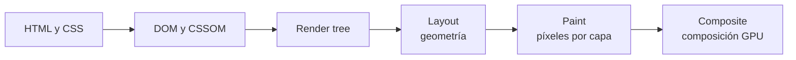

# CSS

## Unidad 14 · Rendimiento y buenas prácticas

**Módulos 0615 (DIW) · 0488 (DI)**

Diseño de interfaces web (DAW) · Desarrollo de Interfaces (DAM)

Curso 2026/2027

Note:
Bienvenidos a la unidad de rendimiento. El CSS afecta a la velocidad en tres frentes: bloquea la primera pintura, suma descarga y obliga a recalcular geometría. Aquí aprendemos a medir cada uno y a atacar el que más pesa. Pregunta de arranque: ¿cuánto CSS se descarga en la primera carga de vuestro proyecto?

---

## Objetivos de aprendizaje

<span class="fragment">1. Explicar la <mark>ruta crítica de render</mark> y dónde bloquea el CSS</span>

<span class="fragment">2. Separar el <mark>CSS crítico</mark> del que se puede diferir</span>

<span class="fragment">3. Reducir peso con minificación, <mark>purga</mark> y compresión</span>

<span class="fragment">4. Elegir animaciones y <mark>contain</mark> con coste bajo por fotograma</span>

<span class="fragment">5. Interpretar los <mark>Core Web Vitals</mark> y la pestaña Coverage</span>

Note:
Cinco objetivos que siguen el orden real de trabajo: entender el pipeline, cargar lo justo, pesar menos, calcular menos y por último medir. El tercero es el que más ahorro aporta en proyectos heredados. El quinto es el que se usa para justificar las mejoras ante un cliente.

---

## Motivación · tres frentes de ataque

<div style="font-size: 1em; text-align: left;">

Un CSS lento se paga en pantalla blanca, en megas descargados y en fotogramas perdidos
</div>

<span class="fragment" style="font-size: 1em;"><mark>Bloqueo del render</mark>: no se pinta ni una línea sin el CSS</span>

<span class="fragment" style="font-size: 1em;">Tamaño de transferencia: cada kilobyte suma en red móvil</span>

<span class="fragment" style="font-size: 1em;">Coste de ejecución: layout y paint caros en cada fotograma</span>

<span class="fragment" style="font-size: 1em;">Las tres cosas se miden: sin número no hay mejora defendible</span>

Note:
Separar los tres frentes es lo que hace posible el diagnóstico: un problema rara vez es de los tres a la vez. El bloqueo es el que nota el usuario en la primera visita, el tamaño el que nota en red lenta y el coste el que nota al interactuar. Con esta división, cada mejora tiene su métrica.

---

## Ruta crítica de render



- El navegador <mark>no pinta nada</mark> hasta tener DOM y CSSOM
- Un CSS grande o lento retrasa el First Paint en cada primera visita
- Cambios de geometría obligan a Layout, Paint y Composite
- Cambios solo de composición terminan en Composite, que es baratísimo

Note:
Este esquema es la base de toda la unidad y conviene saberlo dibujar. Cuanto más a la derecha ocurre el cambio, menos cuesta: ahí está la clave de las animaciones con transform. Un CSS de 500 KB impacta en la fase de construcción del árbol, antes de pintar un solo píxel.

---

## Render-blocking · el problema

<span class="fragment">Un `<link rel="stylesheet">` en el `<head>` bloquea el render hasta parsearse</span>

<span class="fragment">No es pantalla blanca un rato: es espera acumulada en cada primera visita</span>

<span class="fragment">Se mide con throttle de Fast 3G en la pestaña Network</span>

<span class="fragment">En SPAs, dividir por ruta evita arrastrar CSS de toda la aplicación</span>

<span class="fragment">Vite y Next.js ya hacen el split por ti si se usa bien</span>

Note:
La regla del navegador es conservadora: sin estilos no sabe cómo colocar nada, así que espera. Por eso el CSS de cabecera es la prioridad número uno. Medirlo con la red limitada es imprescindible, porque en local siempre parece rápido y el usuario real no vive en local.

---

## Estrategia · crítico y diferido

```html
<head>
  <style>/* CSS crítico: solo lo visible sin scrollear */</style>
  <link rel="preload" href="/css/styles.css" as="style"
        onload="this.onload=null;this.rel='stylesheet'">
  <noscript><link rel="stylesheet" href="/css/styles.css"></noscript>
</head>
```

- El CSS crítico va inline: reset, tipografía, header y hero
- El resto se precarga sin bloquear y se convierte al terminar
- Presupuesto orientativo: menos de 14 KB minificado de crítico
- Reducir es la solución raíz; el truco de carga solo maquilla

Note:
La estructura del preload con swap es el patrón estándar de mejora progresiva: quien no soporta el truco recibe el stylesheet normal. El `<noscript>` es la red de seguridad para el resto. Que el crítico pase de 14 KB significa que se está metiendo en el bloque lo que no debe.

---

## Ejemplo · presupuesto de CSS crítico

```css
*, *::before, *::after { box-sizing: border-box; margin: 0; }
body { font: 16px/1.5 system-ui; }
.hero { min-height: 60svh; padding: 2rem; }
.cabecera { display: flex; gap: 1rem; padding: 1rem 2rem; }
```

- Lo mínimo que se ve sin hacer scroll: reset, tipografía, cabecera y hero
- Las secciones y los componentes se cargan diferidos, con la página ya viva
- Si el crítico pasa de 14 KB, hay selectores que sobran dentro del bloque
- Se escribe con el build o a mano cuando el proyecto es todavía pequeño

Note:
Estas cinco reglas bastan para pintar la primera pantalla completa, que es lo único que el navegador puede mostrar antes de bajar el resto. El presupuesto de 14 KB se comprueba en la pestaña Network mirando el CSS que va inline. Con muchos componentes conviene generarlo con el build en lugar de mantenerlo a mano.

---

## Peso · minificar, purgar, comprimir

- Minificación: entre un 20 % y un 40 % menos con cssnano o Lightning CSS
- Purga de selectores muertos: entre un 30 % y un 80 % en proyectos antiguos
- Cobertura por encima del 80 % de uso antes de publicar
- Compresión Brotli en servidor: entre un 15 % y un 25 % adicional
- Objetivo: una sola hoja principal, por debajo de 100 KB en bruto

Note:
La purga es la que más sorprende: en proyectos heredados hay hojas enteras sin uso. Coverage en DevTools os dice exactamente qué selectores no se aplican nunca. Recordad que duplicar la misma regla en tres archivos no solo cuesta bytes, cuesta mantenimiento cuando hay que cambiarla.

---

## Coste de ejecución por fotograma

<span class="fragment">Composite: `transform`, `opacity` y `filter`, muy barato y en GPU</span>

<span class="fragment">Paint: `background`, `box-shadow` y `border-color`, repinta píxeles</span>

<span class="fragment">Layout: `top`, `width`, `height`, `margin` y `display`, el más caro</span>

<span class="fragment">Un cambio de geometría arrastra las tres fases en cadena</span>

<span class="fragment">Por eso una animación con `top` patina y la misma con `translate` no</span>

Note:
Esta escala es el criterio con el que se decide cómo se anima o cómo se reposiciona cualquier elemento. No hace falta memorizar números, basta con el orden: composite, paint y layout. Cada decisión de CSS se puede justificar con esta jerarquía.

---

## will-change · promoción a capa

```css
/* Bien: justo antes de necesitarla */
.carrusel:hover .slide { will-change: transform; }
/* Mal: una capa por elemento y memoria disparada */
* { will-change: transform; }
/* Al terminar el cambio se retira */
.slide { will-change: auto; }
```

- Adelanta la promoción a capa de composición antes del cambio
- Aplicado en el selector universal crea capas que nadie recicla
- Se retira al terminar: `will-change: auto`
- Regla práctica: nunca dejarlo «por si acaso» en toda una sección

Note:
will-change es una instrucción de anticipación al motor de render, no un adorno. Siempre es mejor aplicarlo con JavaScript justo antes y quitarlo después. En la pestaña Rendering podéis ver las capas activas con Layer borders, y veréis cuántas se crean con el selector universal.

---

## Contención y render diferido

```css
.lista .item { contain: content; }    /* layout y paint acotados */
.widget { contain: strict; }          /* suma size: cuidado */
.seccion-larga {
  content-visibility: auto;
  contain-intrinsic-size: auto 1200px;   /* altura de reserva */
}
```

- `contain: content` es el punto de partida seguro para widgets y listas
- `content-visibility: auto` salta el render de lo que está fuera del viewport
- Sin la altura de reserva el scrollbar salta y aparecen huecos
- La accesibilidad se mantiene: el contenido sigue siendo navegable

Note:
La contención le dice al navegador que una parte es independiente y no debe invalidar el resto. content-visibility va más lejos y deja de pintar lo que no se ve, con ganancias enormes en documentación larga. El matiz de strict es que fija también el tamaño, así que hay que comprobar que nada se mida desde fuera.

---

## Fuentes · el otro cuello de botella

```html
<link rel="preload" href="/fonts/inter.woff2" as="font"
      type="font/woff2" crossorigin>
<style>
@font-face { font-family: Inter; src: url(inter.woff2) format("woff2");
             font-display: swap; }
</style>
```

- Formato WOFF2 con subconjuntos y `unicode-range`
- `font-display: swap` muestra el texto de reserva mientras carga
- Preload solo de la fuente crítica: una familia variable vale por cuatro pesos
- Self-hosting: control de privacidad y una petición menos en la red

Note:
Las fuentes retrasan el texto visible y por eso entran en el LCP. Con swap el contenido se lee de inmediato aunque cambie el dibujo, que es el famoso FOUT, breve e imperceptible. Ojo con `optional`: en titulares casi nunca llegaría a pintarse con la fuente correcta.

---

## Caché y entrega

- Fingerprinting: el build genera `styles.a1b2c3.css` con hash en el nombre
- Con hash en la URL se puede servir caché eterna e immutable
- `Cache-Control: public, max-age=31536000, immutable` para ese archivo
- Brotli como `Content-Encoding: br`, mejor que gzip en torno a un 20 %
- HTTP/2 y CDN reducen latencia; el build sigue haciendo el hash

Note:
El fingerprinting es la pieza clave: como el nombre cambia en cada despliegue, el navegador nunca sirve una versión vieja. Lo hace Vite o Webpack automáticamente. Si el nombre no cambia y ponéis caché eterna, los usuarios verán CSS antiguo hasta que vacíen la caché a mano.

---

## Core Web Vitals

| Métrica | Qué mide | Impacto del CSS |
|---|---|---|
| LCP | Primer gran elemento | Bloqueo y fuentes |
| CLS | Estabilidad visual | Media sin medidas |
| INP | Respuesta a inputs | Trabajo por frame |

- Umbrales: <mark>LCP &lt; 2,5 s</mark> · <mark>CLS &lt; 0,1</mark> · INP &lt; 200 ms
- Laboratorio (Lighthouse) y campo (CrUX) no se igualan
- Se miden en el percentil 75 de las sesiones

Note:
Estas tres cifras son las que se firman en un informe de rendimiento. El CSS pesa sobre todo en el LCP, por el bloqueo, y en el CLS, por las fuentes y la media sin dimensiones. El INP castiga las transiciones pesadas sobre elementos grandes al pasar el ratón.

---

## Diagnóstico con DevTools

<span class="fragment">Network: peso final del CSS y momento en que termina, con red limitada</span>

<span class="fragment">Performance: Layout largos, Recalculate Style repetido y tareas largas</span>

<span class="fragment">Rendering: paint flashing, layer borders y badge de CLS</span>

<span class="fragment">Elements › Styles: especificidad y origen de cada regla aplicada</span>

<span class="fragment">Coverage: porcentaje de CSS realmente usado en la página</span>

Note:
Este es el flujo que conviene seguir en ese orden ante cualquier queja de lentitud. La pestaña de estilos es además la mejor forma de depurar la cascada y de descubrir quién gana en un conflicto. Coverage es el dato que justifica la purga con números y no con impresiones.

---

## Calidad del código CSS

- stylelint con Prettier: orden de propiedades y detección de `!important`
- Una propiedad por línea y orden lógico: caja, tipografía, visual, resto
- Nombres en kebab-case y una única nomenclatura acordada en el equipo
- Comentarios solo para el por qué, nunca para repetir el qué
- Tests visuales: capturas comparadas entre builds en la integración continua

Note:
La calidad no es estética: reduce errores en revisiones y hace el build fallar antes de llegar a producción. El testing visual detecta regresiones que ningún test funcional ve. Si el linter falla el build, la deuda de estilo se mantiene en cero desde el primer día.

---

## Checklist antes de entregar

- Una hoja principal minificada y servida con compresión Brotli
- CSS crítico inline y el resto diferido con preload
- Imágenes con dimensiones y fuentes WOFF2 con `swap` y preload
- Animaciones solo con `transform` y `opacity`, con `will-change` puntual
- `contain` y `content-visibility` en las secciones largas
- Lighthouse móvil con rendimiento por encima de 90 y CLS por debajo de 0.1

Note:
Esta lista es el equivalente de rendimiento al recorrido de accesibilidad de la unidad anterior. Se puede ejecutar en diez minutos sobre cualquier entrega. Si un punto no se puede marcar, hay que justificarlo por escrito en el README del proyecto.

---

## Error común: rendimiento mal diagnosticado

⚠ `will-change` en `*`: RAM y capas huérfanas

⚠ Animar `width`/`top`: repaint constante

⚠ Dejar `will-change` tras el cambio que lo justificaba

⚠ `contain: strict` con medidas externas da saltos

⚠ Hojas sin purgar ni minificar en la primera carga

⚠ Lighthouse en local: la red real cambia el resultado

Note:
El primero y el tercero son de los más frecuentes porque will-change parece inocuo. El cuarto produce bugs difíciles de ver: el componente deja de responder a lo que ocurre fuera. Los dos últimos son de proceso: medir y reducir antes de optimizar detalles.

---

## Autoevaluación

<span class="fragment">1. ¿En qué fase de la ruta crítica impacta una hoja de 500 KB?</span>

<span class="fragment">2. ¿Qué te dice la pestaña Coverage y qué haces con ese dato?</span>

<span class="fragment">3. ¿Qué métrica empeora con `font-display: block` de 3 segundos?</span>

--

**1)** Retrasa la construcción del CSSOM, así que nada se pinta hasta que baja.

**2)** Indica el porcentaje de CSS usado: por encima del 80 % o se purga lo demás.

**3)** Sube el LCP, porque el mayor texto espera a la fuente; se arregla con `swap`.

Note:
La primera pregunta comprueba que se entiende el porqué, no solo el qué. La segunda conecta directamente con la purga de selectores. La tercera une fuentes con métricas y es la que más se parece a un caso práctico de examen.

---

## Claves para el examen

- En la ruta crítica nada se pinta sin DOM y CSSOM: el CSS de `<head>` bloquea
- Crítico inline por debajo de 14 KB y el resto con preload y swap
- Coste por fotograma: composite menor que paint y paint menor que layout
- `will-change` puntual y retirado; `content-visibility` con altura de reserva
- Fuentes en WOFF2 con `swap` y preload de la crítica
- Core Web Vitals: LCP menor de 2.5 s, CLS menor de 0.1 e INP menor de 200 ms

Note:
Seis ideas que cubren medición, carga, coste y entrega. Las dos primeras son las que más se preguntan en teórico, y las de métricas se repiten en práctico. Si domináis la jerarquía de coste por fotograma, justificáis cualquier decisión de animación.
